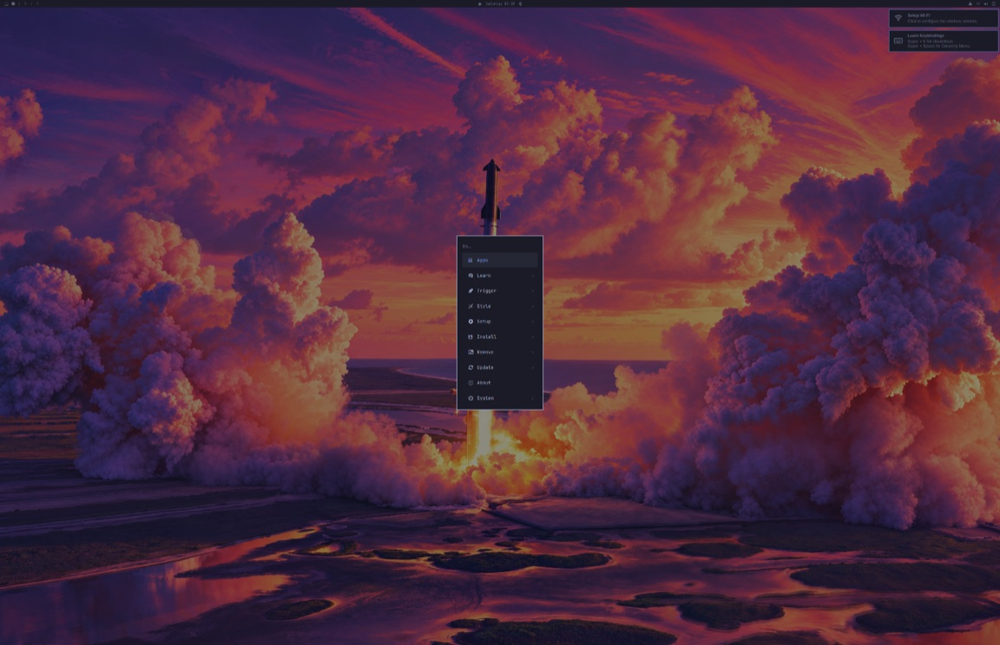

# Omarchy itself as an M5 RAM root: built by Omarchy's installer, booted in the VM (job 045)

2026-10-17, updated 2026-10-18 · VM job
[`045-omarchy-installer-root`](../virtualization/jobs/045-omarchy-installer-root/run.sh) · follows
job 039's Omarchy-style root ([run-33 report](ram-root-report-2026-10-16.md)) · nothing
committed. **VM results only: nothing here ran on the M5.** Labels: Confirmed / Likely /
Hypothesis / Unknown; "Confirmed" means confirmed in the VM or in the build, never on the M5.

**Update 2026-10-18:** the root was rebuilt with the two changes VM job
[048](../virtualization/jobs/048-omarchy-compositing/README.md) proposed: deviation 15,
`QT_WAYLAND_FRAME_CALLBACK_TIMEOUT=0` for the session, which stops Omarchy's shell from
repainting after every frame, and a test probe whose readiness check no longer waits on
`hyprctl`. The figures below are the rebuild's; the 2026-10-17 run's stay where they compare.
**The image changed** (size and SHA-256 under "Evidence"); option B's launcher pin was redone
for it the same day (under option B). Later the test harness got three fixes and booted the
same image again, which passed; the image's bytes did not change ("VM boot test").

## The bar

**Omarchy** means: built by Omarchy's own installer, from Omarchy's own repositories, and
running Omarchy's own session, with deviations only where the M5's hardware forces them (our
kernel and DT instead of Omarchy's, no bootloader, packages for absent hardware). Everything
short of that is **Omarchy-style**. Job 039's RAM root (attempts 19 and 20) is Omarchy-style: 27
hand-picked Arch Linux ARM packages with Omarchy's configuration, a session of our own and no
Omarchy shell, first run or default apps. Job 045's root is the first one that is Omarchy.

## Result

**Confirmed (VM): Omarchy's own installer built the root, and Omarchy's own session ran from it
on the exact boot035 Image.** The final run (2026-10-18: one `host-run.sh` invocation, 33 min,
reusing the install) packed the image and booted it on one TCG vCPU the way m1n1 boots the M5:
the blob in RAM with its bounds in `/chosen`, the launcher's RAM-root arguments plus m1n1's
append, the M5's root `compatible`, and a 3456×2234 simple-framebuffer driven by simpledrm with
llvmpipe. Answers:

* **Omarchy's session came up:** SDDM's autologin started `uwsm` → Hyprland 0.56.2 →
  Quickshell, Omarchy 4's shell, with its `omarchy-background`, `omarchy-bar`, `omarchy-dock`
  and `omarchy-notifications` surfaces. The shell answered its IPC ping, the **desktop ready
  194.8 s after kernel start** (TCG; 246.2 s in the 2026-10-17 run, whose probe also waited for a
  `hyprctl` reply).
* **The shell no longer repaints after every frame** (deviation 15, cause found by VM job 048).
  Without it, each Quickshell window missed Qt Wayland's 100 ms frame-callback timeout on every
  CPU-rendered frame and was repainted in full, so Hyprland composited back to back. In this run
  Quickshell used about 5 CPU-seconds in the 371 s from the settled desktop to the end
  (2026-10-17: 123 in 1,076 s), and the probe's whole flow took 695 s instead of 1,429 s. At an
  idle desktop job 048 measured Hyprland at 5 % of the CPU with the change and 81–82 % without.
* **First run completed** (202.2 s): every step of `omarchy-provision-first-run`; its "Setup
  Wi-Fi" and "Learn Keybindings" notifications are on screen. Its agent invitation is installed
  as a post-update hook, so it appears after Omarchy's first update, not at first login (Likely,
  from `omarchy-provision-first-run`).
* **The menu opens:** `omarchy-menu summon` (what SUPER + SPACE runs) showed Omarchy's menu (Apps,
  Learn, Trigger, Style, Setup, Install, Remove, Update, About, System).
* **Chromium and the Electron app start on the 16 KiB-page kernel:** Chromium 153 drew its New
  Tab page (window 17 s after the launch, TCG; 554 s on 2026-10-17) and Obsidian 1.14.4 on its
  bundled Electron its vault chooser (56 s; 156 s); **no core dump**. Obsidian is the only
  Electron app in the set; the other Chromium-based code is QtWebEngine. A static check of all
  6,575 ELF files finds two that cannot map on 16 KiB pages, both copies of an x86-64 `shfmt`
  that `omarchy-nvim` ships.
* **What fails, and why:** four units, all from our kernel or the M5's identity: `ufw` (no
  `nf_tables`), `linux-modules-cleanup` (no modules for our kernel), the user's
  `xdg-document-portal` (no FUSE), and the last of the 51 deferred hardware steps, because Omarchy
  recognizes the M5 as `aarch64-apple` and asks for `omarchy-mac-boot`, which must not be
  installed. Three gaps needed a change: our kernel has no zram (a 90 s stall per boot), with
  no input driver Omarchy's idle chain darkened the panel, and with no GPU driver every frame
  rendered on the CPU outlasts Qt Wayland's frame-callback timeout (deviation 15).
* **Memory:** 13,801 MiB in use at the settled desktop, of which 10.2 GiB is the root itself
  held in tmpfs; 14,120 MiB with Chromium and Obsidian open.
* **Size:** 8.53 GB unpacked in 215,133 entries, **10.77 GB in 16 KiB pages**; the delivered
  image is **2,337,897,871 bytes** (`zstd --ultra -22 --long=27`), **444.5 s** of upload at
  5.36 MB/s. It fits neither the launcher's 300 s deadline nor the about 1.03 GB its m1n1 heap
  leaves for an initrd.
* **Delivery:** a pruned root cannot fit without leaving Omarchy behind. **B now:** the same
  root in one stage with two launcher constants changed (heap and deadline; proposed, not made).
  **C next:** a small first stage through the proxy and this root over the USB link into RAM.
  The rebuild changed the image; B's launcher pin now names the new one (under option B).



*The guest's simple-framebuffer 420 s after kernel start, downscaled: Omarchy's wallpaper, the
Quickshell bar (small: Hyprland's `auto` scale is 1 without an EDID), the first-run
notifications and Omarchy's menu. 2026-10-17 run; the 2026-10-18 capture differs in 297 pixels
at half scale, nearly all in the bar's clock and date.*

## Which Omarchy: the edge aarch64 ISO's runtime

Omarchy's edge repository for aarch64 (`pkgs.omarchy.org/edge/aarch64`) carries two runtimes
(Confirmed, `out/install/omarchy-repo-packages.txt`):

* `omarchy` 4.0.4-2 with `omarchy-settings` 4.0.4-6, the published release;
* `omarchy-dev` and `omarchy-settings-dev` 4.0.0.r7028.g33783b1-1, "quattro branch tip".

The published 4.0.4 runtime cannot finish an aarch64 install. Its own installer scripts
(Confirmed, kept in `out/inspect/installed/`) show three gaps, and a first build with it failed
on the first two (Confirmed in that build's logs, which later runs of the job replaced):

* Its user setup looks only for a `node-v*-linux-x64.tar.gz` Node tarball
  (`install/user/mise-work.sh`), so `omarchy-provision-user --first-install` failed with
  "bundled Node.js tarball missing".
* It has no image-build mode (no `install/helpers/image-target.sh`), so its hardware steps ran
  against the build VM. `apple/fix-spi-keyboard.sh` failed there (cause not examined), which
  ended `omarchy-apply-system` before login and post-install.
* It has no aarch64 package list.

Omarchy builds its own aarch64 installer the other way. `bin/omarchy-iso-make` documents aarch64
as `--arch aarch64 --edge`, and `builder/build-iso.sh` says: "Edge, dev, and local-source ISOs
install the dev packages explicitly. Those package recipes track the quattro branch". Its
`test/arm64-install` sets `RUNTIME_PACKAGE=omarchy-dev SETTINGS_PACKAGE=omarchy-settings-dev`
(omarchy-iso quattro `db483455`, read, never run). Job 045 therefore installs what that edge
aarch64 ISO installs: **`omarchy-dev` and `omarchy-settings-dev`**, whose installer has the
aarch64 lists, the arm64 Node tarball and the image-build mode.

## How it was built

Job 045 runs in the workspace job VM under the `vm` lock. It installs into a btrfs subvolume, as
an installed Omarchy root is, on its own 10 GiB sparse work disk, and follows the phases of
Omarchy's ISO orchestrator (`main.py: build_phases`, `phases_impl.py`) one by one:

| ISO phase | Job 045 (`install.sh`) |
|---|---|
| Installing Arch + Omarchy | pacstrap-style install (`pacstrap -K` keyring): `base base-devel`; zram-generator (archinstall's swap); the early set `base-devel git omarchy-keyring archlinuxarm-keyring omarchy-settings-dev`, then `lua51 luarocks`, then `omarchy-nvim`; the user (archinstall's `useradd -m -G wheel` and sudoers entry); archinstall's PipeWire selection; the runtime `omarchy-dev`; the ISO builder's aarch64 default set from the runtime's own lists (164 names, identical to `omarchy-pkg-defaults aarch64`); `snapper`; hostname, locale, keymap, timezone, NTP |
| Configuring hibernation | not applicable (no disk) |
| Configuring system | `omarchy-apply-system --install-user omarchy --first-install` in the chroot with the ISO's environment, declared as an **image build for `aarch64`** (`/var/lib/omarchy/image/target`): Omarchy queues its 51 hardware steps for the machine's first boot and asks that boot for the machine's own pacman keyring. Exit 0, 17 steps |
| Staging provisioning | the bundled Node tarball stashed in `/var/lib/omarchy/provisioning/packages` |
| Finalizing Limine boot | not applicable (no bootloader) |
| Finalizing user | `omarchy-provision-user --force --first-install` as the user, the ISO's Node tarball (nodejs.org `latest`, linux-arm64, checksum-verified) at `/opt/packages`. Exit 0: theme, Chromium, git, XCompose, input method, mise work dirs and Node, the user hardware leaves, the default keyring, **`mise.sh` (the agent wrappers: `claude`, `codex`, `crush`, `agy`, `gh`, `copilot`, `opencode`, `pi`, `omp`, `grok`, `kimi`, `cursor-agent`, …)**, and the platform's user setup ("waits for first run on the machine") |
| Configuring login | the ISO's SDDM state and its encrypted-install autologin (`User=omarchy`, `Session=omarchy.desktop`), `sddm.service` enabled |
| SSH access, Tailscale | no-ops without an autoinstall drive, as on the ISO |
| Configuring DNS resolver | `/etc/resolv.conf` → systemd-resolved's stub |
| Validating boot setup, factory snapshot | not applicable (no bootloader, no disk) |

The install took 105 s with a warm package cache (the first, cold one about 4.5 min, retries
included): **865 packages** (153 explicit), 7,736 MiB by pacman's installed sizes. Omarchy's
mirrors reset connections on large files during the first download (LibreOffice,
`qemu-user-static`); the job retries a download error up to five times and pacman resumes the
files.

`ramroot.sh` then takes a btrfs snapshot of the install and makes the RAM root from it, so the
install stays as Omarchy's installer left it and every change is in one place.

## Deviations from stock Omarchy

Each deviation names what forces it; "our kernel" means the boot035 Image and DT that m1n1
loads on the M5 instead of Omarchy's kernel package. `out/deviations.tsv` holds every one as the
step that makes it recorded it (19 lines, grouped into the rows below).

| # | Kind | Deviation | Forced by |
|---|---|---|---|
| 1 | omitted | The kernel package (`linux-aarch64`), its headers and `linux-firmware` | Our kernel. No file in `linux-firmware` is for the M5's hardware |
| 2 | omitted | `limine`, `efibootmgr`, `limine-mkinitcpio-hook`, `limine-snapper-sync`, and the ISO's Limine setup, UKI build and boot validation | No bootloader: m1n1's proxy loads the kernel, and the Mac's boot chain must stay as installed |
| 3 | omitted | `fstab`, hibernation, the `@factory` snapshot | No disk: the root is the initramfs |
| 4 | omitted | archinstall's network-config copy from the live ISO | No live ISO, and no network device on the M5 in this path |
| 5 | changed | No password for the user or root (the configurator sets the human's) | The image holds no credentials, and there is no keyboard to type one |
| 6 | changed | SDDM autologin, as the ISO writes it for an encrypted install, on a root with no LUKS prompt | No keyboard or trackpad driver yet, no password |
| 7 | changed | Omarchy's own Stay Awake toggle on (`~/.local/state/omarchy/indicators/stay-awake`, what `omarchy-toggle-idle stay-awake` writes) | No input device ever ends idle. In the first boot test the idle chain (screensaver, lock, display off) blanked the panel: every capture from 900 s on was black (the desktop had appeared at 316 s), and the shell's log shows its lock surface |
| 8 | changed | `zram-generator` masked (`/etc/systemd/system-generators/zram-generator` → `/dev/null`) | Our kernel has no `CONFIG_ZRAM`. `/dev/zram0` never appears, and systemd waited 90 s for it before `sysinit.target` on every boot (first boot test: the probe started at 133.6 s, against 52.6 s with the mask) |
| 9 | changed | The build's pacman keyring left out | `pacstrap -K` made it, with a private master key. Omarchy's image-build mode leaves the keyring to the machine's first boot, which deletes and remakes it anyway |
| 10 | build-host | `vm-no-animations.sh`'s two toggles undone (no-animations, window-opaque) | The user setup ran in the build VM, where `omarchy-hw-vm` is true; on the M5 it is false |
| 11 | added | `/init`: job 039's, from `omarchy-arm64/ram-root/overlay/init` at `HEAD` | The root is the initramfs. `/init` bind-mounts it onto itself, so bubblewrap's `pivot_root` works, and execs systemd |
| 12 | added | `/etc/.updated`, `/var/.updated`, as `systemd-update-done` writes them after a first boot | A RAM root never keeps that state, so the update units would rerun on every boot; pacman's hooks already ran them |
| 13 | added | `/usr/share/ilinux/build-info.txt` | Provenance: what was built, from what |
| 14 | changed | Timezone UTC (the configurator asks or detects it) | The image carries no location |
| 15 | changed | `QT_WAYLAND_FRAME_CALLBACK_TIMEOUT=0` for the session (2026-10-18): `hl.env("QT_WAYLAND_FRAME_CALLBACK_TIMEOUT", "0")` in `~/.local/state/omarchy/toggles/hypr/ilinux-frame-callbacks.lua`, Omarchy's own toggles directory, which its Hyprland config loads; Hyprland starts the shell, which inherits it | No GPU driver: Hyprland renders on the CPU (llvmpipe), slower than Qt Wayland's default 100 ms frame-callback timeout. A late callback makes Qt count a window as hidden and repaint all of it when the callback comes, so every shell window was repainted after every frame and Hyprland never went idle: 81–82 % of the CPU at an idle desktop under TCG, 5 % with the change (VM job 048). On the M5 a full-screen frame should take about 0.6–1.1 s, so the loop would run there too (Likely, estimated by job 048) |

Deviation 15's side effect (job 048, from Qt's source): Qt no longer counts a window as hidden
when Hyprland stops sending it frame callbacks (a window on another workspace, behind the lock).
Such a window still renders only when its content changes, so the cost is one frame per change,
not a loop. Omarchy's shell lives on layer surfaces that are always shown.

**Configurator answers, not deviations:** user `omarchy` with no full name or e-mail, hostname
`omarchy` (the configurator's default), `en_US.UTF-8`, keymap `us`, no input method.

**Build environment, not image content:**

* The installer ran in a chroot in a VM, so the build declares an **image build for `aarch64`**
  (`/var/lib/omarchy/image/target`, format 1). That is Omarchy's own mechanism for roots built
  away from their machine: it defers the 51 hardware steps to the machine's first boot and asks
  that boot for its own pacman keyring.
* The ISO's offline mirror is replaced by Omarchy's online edge templates, as an online ISO
  install uses. `post-install/pacman.sh` then writes the runtime's own templates.
* The package cache stays outside the root, as for a pacstrap with the host's cache.
* The ISO's bundled Node tarball is downloaded the way the ISO builder downloads it (nodejs.org
  `dist/latest`, `linux-arm64`, SHA-256 checked).

**Not changed, though they fail on our kernel or platform (see the boot test):** `ufw.service`
(no `CONFIG_NF_TABLES`), `linux-modules-cleanup.service` (no modules for our kernel), the
user's `xdg-document-portal.service` (FUSE is a module our root does not ship), and
`omarchy-provision-hardware.service`, which stops at its last step because Omarchy recognizes
the M5 (below).

## VM boot test

`boot-test.sh` boots the image in QEMU 11.1.2 (TCG, `-cpu max` without SVE, SME or pointer
authentication, one vCPU, 32 GiB) inside the job VM, which this job runs with 48 GiB. What
matches the M5:

* the exact boot035 Image (`1131a1af…`), entered directly;
* the launcher's RAM-root arguments plus m1n1's `idle=nop arm64.nowfxt`, with `console=hvc0`
  added for the test's markers;
* the initrd as m1n1 places it: the image written into RAM, its bounds in
  `/chosen/linux,initrd-start` and `-end`. QEMU's `-initrd` refuses files of 2 GiB or more
  (2,047 MiB loads, 2,049 MiB does not; `out/qprobe.txt`), so the blob goes in through QEMU's
  generic loader in 1 GiB pieces;
* the M5's root `compatible` (`apple,j716c`, `apple,t6050`, `apple,arm-platform`) and model,
  so Omarchy's platform detector answers as it will on the M5;
* a `/chosen` simple-framebuffer of the 16-inch panel (3456×2234, `x2r10g10b10`) in reserved
  RAM, which simpledrm drives;
* no network to the outside: one VM-only virtio NIC (user mode, `restrict=on`) that
  NetworkManager is told to leave alone, so NetworkManager sees no device, as on the M5.

A second cpio appended to the image (`test-overlay/`, VM only) adds a probe, a test sshd on
that NIC and the 9p results share. The probe marks each milestone on the virtio console, asks
the harness for framebuffer captures, and drives the session the way its bindings do: the menu
through `omarchy-menu`, apps in the user's systemd manager (`omarchy-launch-browser`,
`uwsm-app -- obsidian`).

Since 2026-10-18 the probe waits on no `hyprctl` reply (job 048's readiness change). Under TCG
Hyprland answers its socket between frames that take seconds, and `hyprctl` gives up after 5 s,
so the old gate could wait an hour or more for "ready" (job 047: 2,002 and 4,909 s on a
boot039-family Image). The probe now sends `hyprctl`'s own requests over Hyprland's socket with a
120 s limit, pings the shell on the shell's socket with a 20 s limit whatever Hyprland is doing,
and reads layers and app windows from Hyprland's event socket (`socket2`, kept in
`results/hypr-events.txt`). "Ready" still means the shell answers its ping and has a layer
mapped.

Later on 2026-10-18 the harness was fixed in three places and the same image was booted again
with `RETEST=1`, which runs the boot test alone on the packed image after checking its digest,
so the image kept its bytes:

* the harness finds a marker anywhere in a console line. The serial getty's login prompt shares
  `hvc0` and ends without a newline, so it prefixes the next marker (in both runs SDDM's:
  `omarchy login: ILINUX045-SDDM 101.55` in the rerun); `summary.txt` now lists SDDM, and a
  prefixed capture request, `READY` or `DONE` can no longer stall or fail a run;
* the probe calls Hyprland 0.56.2's dispatchers in the Lua form its IPC evaluates
  (`return hl.dispatch(…)`), as Omarchy's own scripts do: `hl.dsp.exec_cmd("true")` answers `ok`,
  where the old `exec true` was a Lua syntax error;
* each app is closed before the next one starts (under "Apps").

The rerun passed: ready at 201.9 s, done at 655.3 s (wall 656 s), the same four failed units, no
core dump. Jobs 047 and 048 source `boot-test.sh` and boot this `test-overlay/`, so their next
runs get the three fixes too; their own console greps (job 047's lines per variant, job 048's
`exit.txt`) still match a marker only at the start of a line.

### Timeline (TCG, seconds after kernel start)

| Milestone | Final run (2026-10-18) | 2026-10-17 run | First boot test |
|---|---|---|---|
| systemd starts (`Startup finished`: kernel part, including the unpack of 2.34 GB into 8.56 GB) | 43.5 | 44.5 | 39.7 |
| `graphical.target` (userspace part) | +57.9 | +61.9 | +138.9 |
| SDDM | 100.7 | 105.8 | 178.8 |
| Autologin session (`omarchy`, seat0, tty1) | 103.3 | 108.3 | 178.9 |
| Hyprland | 108.0 | 113.0 | 185.9 |
| Quickshell, first run starts | 112.6 (the shell's journal; the probe, waiting on a Hyprland reply, saw it at 139.8) | 117.8 | 190.6 |
| Output `Unknown-1` 3456×2234 in Hyprland | 127.3 | 160.8 | 231.9 |
| First run done | 202.2 | 231.1 | 301.8 |
| Shell surfaces: `omarchy-background`, `-bar`, `-dock`, `-notifications` | 162.4, 162.5, 191.1, 212.4 (Hyprland's events) | 244.1 (the first `hyprctl` reply) | ≤ 315.6 |
| **Desktop ready** (the shell answers its IPC ping) | **194.8** | **246.2** | 676.7 |
| Settled (60 s later): memory in use | 288.4: 13,801 MiB | 340.0: 13,658 MiB | 738.1: 14,024 MiB |
| Menu open | 358.7 (`omarchy-menu` among the layers) | 419.6 | 808.5 (black: idle) |
| Chromium window / Obsidian window | 17 s / 56 s after launch | 554 s / 156 s | none (launch failed) |
| Probe done | **694.8** | 1,429.0 | 2,684.7 |

The 2026-10-17 run is the same image without deviation 15, booted with the old probe. Job 048
measured the two changes apart: deviation 15 with the old probe, on boot035, was ready at
249.6 s and done at 810.7 s; the new probe without deviation 15, on job 047's Image with the
loop running, was ready at 215.5 s. With both, the shell answered its first ping at 194.6 s,
and every later step is faster because Hyprland draws the apps and the menu instead of the
shell's repaints. Window times are when the probe saw the window: through Hyprland's events now
(Chromium's `openwindow` 15.3 s after its launch, Obsidian's 48.3 s), through `hyprctl` before.

The first boot test is the same image before two of the deviations: without the zram mask
systemd waited 90 s for `/dev/zram0` (most of the 77 s difference in `graphical.target`), and
without Stay Awake every capture from 900 s on was black. Its apps were launched with
`hyprctl dispatch exec`, which started nothing; Hyprland's IPC often timed out under TCG
(`probe.log`). The final run launches them in the user's systemd manager, as Omarchy's own
launchers do.

### CPU: the shell's repaint loop before and after deviation 15

CPU-seconds from the probe's process snapshots (`ps`: lifetime share × elapsed time) at the
settled desktop and at the end. Job 045's flow has no idle stretch, so the second window
includes Hyprland drawing the menu and both apps on the CPU; job 048 measured the idle desktop
(run C: Hyprland 5 % against 81–82 %, Quickshell 0 % against 13–14 %).

| One TCG CPU | Final run (2026-10-18) | 2026-10-17 run |
|---|---|---|
| Hyprland, its start to the settled desktop | 56 CPU-s in 179 s (31 %) | 106 CPU-s in 203 s (52 %) |
| Hyprland, settled desktop to the end | 217 CPU-s in 371 s (58 %) | 862 CPU-s in 1,076 s (80 %) |
| Quickshell, its start to the settled desktop | 23 CPU-s in 176 s | 33 CPU-s in 200 s |
| **Quickshell, settled desktop to the end** | **about 5 CPU-s in 371 s (1 %)** | **123 CPU-s in 1,076 s (11 %)** |

### Units

| Unit | Result | Cause | Label |
|---|---|---|---|
| `ufw.service` | failed | boot035 has no `CONFIG_NF_TABLES`, which iptables-nft needs | Likely |
| `linux-modules-cleanup.service` | failed | no `/usr/lib/modules` tree for our kernel in the root | Likely |
| `omarchy-provision-hardware.service` | failed, exit 75, after 49.9 s (53.7 s on 2026-10-17) | 50 of 51 deferred steps ran; `platform-setup.sh` stopped with "setup-boot on aarch64-apple needs omarchy-mac-boot … it is not installed" (exit 3) | Confirmed |
| `xdg-document-portal.service` (user) | failed | its FUSE mount: FUSE is a module (`=m`) and the root ships no modules for our kernel | Likely |
| everything else | 0 other failed units; no core dumps | | Confirmed (VM) |

`omarchy-provision-hardware` is also the slowest unit of the boot (49.9 s under TCG): it makes
the machine's pacman keyring and runs the deferred steps. A RAM root forgets both, so it runs
again on every boot, as does the first run with its notifications.

### Apps

| App | Process | Window | Memory then | Label |
|---|---|---|---|---|
| Chromium 153.0.8010.36 (`omarchy-launch-browser`, `--ozone-platform=wayland`) | 3 s (rerun 4 s) | 17 s (rerun 17 s; 554 s on 2026-10-17) | main process 273 MiB RSS; GPU process on `card0` | Confirmed (VM) |
| Obsidian 1.14.4, bundled Electron (`uwsm-app -- obsidian`) | 5 s (5 s) | 56 s (15 s; 156 s) | main 219 MiB, renderer 202 MiB | Confirmed (VM) |

Both rendered (captures `app-chromium.png`, `app-obsidian.png`: Obsidian over Chromium in the
morning run, alone in the rerun). jemalloc, whose page size can be fixed at build time, is
linked by Quickshell and `fd` only; Quickshell ran.

After each app the probe closes its windows the way Omarchy's `omarchy-hyprland-window-close-all`
does, by address with `hl.dsp.window.close({ window = "address:…" })`, waits 10 s, and ends
whatever is left of the app with `pkill` on its command line (the window-class pattern without
its `^`, since a command line starts with a path). In the rerun both closes answered `ok`,
Hyprland's `closewindow` event followed within 3 s, and neither app had a process left for
`pkill`: Chromium and Obsidian exited on their own (`results/probe.log`, `hypr-events.txt`). The
final snapshot lists no window and no Chromium or Obsidian process. Obsidian's window came 15 s
after its launch, against 56 s in the morning run, whose probe had left Chromium open to the
end: its `closewindow` request was a Lua syntax error, and its `pkill` pattern `^chromium` never
matched `/usr/lib/chromium/chromium`.

### Memory

| | At the settled desktop | With Chromium and Obsidian |
|---|---|---|
| In use (MemTotal − MemAvailable) | 13,801 MiB (2026-10-17: 13,658) | 14,120 MiB (14,175) |
| Shmem (the root in tmpfs, with `/run` and `/tmp`) | 10,456 MiB (10,454) | 10,575 MiB (10,571) |
| AnonPages | 1,253 MiB (1,253) | 1,844 MiB (1,832) |
| Quickshell / Hyprland RSS | 900 / 531 MiB (884 / 537) | 967 / 627 MiB (952 / 632) |

The root costs its page-rounded size in RAM for as long as the machine runs: 10.77 GB of
128 GiB on the M5. The 143 MiB more in use at the settled desktop is not in Shmem, AnonPages or
the page cache (each within 3 MiB of the 2026-10-17 run); only MemFree differs (Unknown which
kernel allocation).

The second column is the morning run's Obsidian snapshot, taken with Chromium still open behind
it. The rerun closes each app before the next: 13,749 MiB in use at its settled desktop,
13,961 MiB with Chromium, 13,965 MiB with Obsidian.

## Size and upload

| Quantity | Value | Label |
|---|---|---|
| Packages | 865 (153 explicit); 7,736 MiB by pacman's installed sizes | Confirmed |
| Unpacked root | 8,525,249,287 bytes in 215,133 entries (2026-10-17: 218 bytes and one entry fewer, the file of deviation 15) | Confirmed |
| The same in 16 KiB pages (what tmpfs holds) | 10,773,544,960 bytes | Confirmed (computed from file sizes) |
| cpio | 8,561,316,352 bytes | Confirmed |
| Job 039 run 33, for comparison | 855.0 MB unpacked, 21,626 entries, 182,420,823 bytes compressed | Confirmed |

| zstd | Bytes | Compress | Decompress, one thread |
|---|---|---|---|
| `-3` | 3,093,567,019 | 5.0 s (12 threads) | 4.76 s |
| `-19 --long=27` | 2,371,498,148 | 249.1 s (12 threads) | 5.37 s |
| `--ultra -22 --long=27` (delivered) | **2,337,897,871** | 624.7 s (6 threads) | 6.19 s |
| `-19 --long=27`, without documentation, translations, headers, static libraries (7,430,792,891 bytes unpacked) | 2,193,557,346 | 224.3 s | 4.88 s |

The delivered image grew by 61,133 bytes (2026-10-17: 2,337,836,738) for 218 bytes more input.

Decompression times are the build VM's (a performance core of the M5 host under
Virtualization.framework). The M5's boot CPU ran attempt 20's single-thread benchmarks at about a
fifth of this machine's macOS baseline, so the kernel's unpack of the delivered image may take
about 30 s natively (Hypothesis).

Where the bytes are (unpacked): `/usr/bin` 1,630 MiB (`qemu-user-static` alone 551 MiB),
LibreOffice 465, fonts 450, Chromium 416, Obsidian 347, translations 310, documentation 196,
QtWebEngine 185, SuperWhisper 169, Omarchy's own tree 167, LLVM 163, Python 140, GCC 134
(`out/build/size-top-dirs.txt`, `out/install/package-sizes.txt`).

## Delivery design

### Today's path and its two limits

`launch.py --profile ramroot` uploads the boot035 Image (44,599,808 bytes), the RAM root and the
Stage-B DT (60,363 bytes) through m1n1's USB proxy. Attempt 20 measured **5.36 MB/s**: 227,080,994
bytes in 42.38 s, with 2.2 s of the 44.55 s launch spent outside the upload. Two limits apply, and
the second binds first:

1. **The 300 s deadline** for the whole launch (`PROFILES["ramroot"]`). At 5.36 MB/s that leaves
   room for an initrd of at most **about 1.55 GB**, with no margin.
2. **The proxy client's heap.** The launcher places the kernel, the DT and the initrd with
   `memalign` from m1n1's `ProxyUtils` heap, which is 1 GiB by default
   (`proxyclient/m1n1/proxyutils.py`, `heap_size=1024 * 1024 * 1024`; `launch_session` calls
   `utils_factory(proxy)` with no size). After the kernel (`image_size` 45,613,056 bytes at
   2 MiB alignment), the DT and the client's own buffers, about **1.03 GB (0.96 GiB)** is left for
   the initrd. Inferred from the code at m1n1 `57a9339`, not tested.

| Image | Bytes | Upload with Image and DT at 5.36 MB/s | Deadline (300 s) | Heap (≈ 1.03 GB) |
|---|---|---|---|---|
| Job 039 run 33 (Omarchy-style) | 182,420,823 | 42.4 s (measured) | fits | fits |
| Job 045, `zstd -3` | 3,093,567,019 | 585.5 s | exceeds | exceeds |
| Job 045, `zstd -19 --long=27` | 2,371,498,148 | 450.8 s | exceeds | exceeds |
| **Job 045, `zstd --ultra -22 --long=27`** (`out/ramroot.cpio.zst`) | **2,337,897,871** | **444.5 s** | exceeds | exceeds |
| Job 045 without documentation, translations, headers and static libraries, `-19 --long=27` | 2,193,557,346 | 417.6 s | exceeds | exceeds |

### Option A, a pruned root that fits today's launcher: rejected

It would have to shrink to about 1.03 GB compressed, 56 % below the delivered image. Removing
everything a RAM root never reads (documentation, translations, headers, static libraries:
1.09 GB unpacked) saves only 6 %. The rest would have to come out of Omarchy itself. The largest
packages by installed size are `qemu-user-static` (551 MiB), `libreoffice-fresh` (466), `chromium`
(439), `obsidian` (366), `noto-fonts-cjk` (299), `qt6-webengine` (272), `gcc` (189),
`superwhisper-bin` (170), `llvm-libs` (164) and `webkit2gtk-4.1` (159). A root without them is
Omarchy-style again, which is what job 039 already is.

### Option B, the unpruned root in one stage, with two launcher constants changed: shortest path

No new kernel, DT or USB function: the boot035 package as attempts 19 and 20 used it. **Proposed,
not made** (`launch.py` is a reviewed controller file):

* the `ramroot` profile asks m1n1 for a larger client heap, for example
  `ProxyUtils(proxy, heap_size=3 * 1024**3)`: room for the 2.34 GB image, the kernel and the DT;
* its deadline goes from 300 s to 900 s: the upload takes 444.5 s at 5.36 MB/s and 596 s at
  4 MB/s, the low end the launcher's comment allows;
* `ramroot-manifest.json` pins job 045's image (size, SHA-256, `image_sha256` of boot035), and
  `test_ramroot.py` gains cases for the larger heap and deadline.

Costs and risks: about **7.5 minutes of proxy upload** per boot (Inferred); a 3 GiB block above
m1n1's own heap, which the 128 GiB machine has room for but nobody has checked against m1n1's
memory map (Hypothesis: fine); the kernel then decompresses 2.34 GB into 8.56 GB of cpio and
fills **10.8 GB of tmpfs** on one CPU, about 30 s natively (Hypothesis; see "Size and upload").

**The pin was redone for the rebuilt image (2026-10-18).** The launcher change made for B after
this report (the `omarchy` profile, approved 2026-10-17) first pinned the 2026-10-17 image
(2,337,836,738 bytes, SHA-256 `5c74bced…24f7`). Its record
`native/boot/omarchy-root-manifest.json`, the exact pin in `native/boot/test_ramroot.py` and the
draft checklist `tools/m1n1-client/omarchy-root-instructions.md` now name the rebuilt image:
2,337,897,871 bytes, SHA-256 `d00ba1563312e69ce366b316dab245ea76226c4f0399a6e32d36932aaa63578a`.
`test_ramroot.py` passes its 44 cases, and the offline launcher with the boot035 records accepts
the new image and refuses the 2026-10-17 one. The upload estimate stays the same to 0.1 s
(444.5 s at 5.36 MB/s, 595.6 s at 4 MB/s).

### Option C, two stages: the target once the USB link carries data

1. **Stage 1 through the proxy, within today's limits:** a small RAM root (job 039's size class,
   about 180 MB, about 45 s) on a kernel and DT with device-mode USB (the boot039 family). It
   brings up the USB link that the USB-link session is building (a bulk-only `gser` byte pipe
   with `sshd -i` on it, the M1's `usb-pipe` tool as ssh's ProxyCommand;
   `native/boot/usb-ssh-link-2026-10-16.md`) and waits for stage 2.
2. **Stage 2 over the link into RAM:** the M1 sends job 045's `ramroot.cpio.zst` through that
   pipe, for example `ssh m5 ilinux-stage2-receive < ramroot.cpio.zst`. The receiver writes it to a
   tmpfs, refuses it unless its SHA-256 equals the digest **pinned inside stage 1** (both built
   together, as `ramroot-manifest.json` pins stage 1 today), unpacks it into a fresh tmpfs
   mounted at `/newroot`, and stage 1's PID 1 hands over with `switch_root` to
   `/usr/lib/systemd/systemd` (a real mount, so job 039's bind-mount `/init` is not needed there).
3. **If anything fails, stage 1 stays up:** its own desktop and log, so a failed transfer is
   observable, unlike a failed proxy upload.

Throughput decides how much faster this is. The DT sets the controllers to high speed
(480 Mbit/s); a raw bulk stream there typically carries 35–40 MB/s, so 2.34 GB would take about
60–70 s (Hypothesis). Through the tty and ssh layers it may be several times slower, and the
link's speed on the real hardware is unknown until attempt 21 or 22 (Unknown). Even at 10 MB/s
(234 s) the two stages beat option B's upload, and the link stays up for SSH and the M1's HTTPS
proxy afterwards, which the agent tools need (below). New pieces: the stage-1 root, the receiver,
the M1's send command and a launcher pin for the boot039-family package; no kernel change beyond
boot039's.

### Recommendation

**B now, C next.** B puts the installer-built Omarchy on the M5's panel with the boot035 package
that is already proven, at the cost of a 7.5-minute upload and two reviewed constants. C replaces
it once the USB link has carried data on the real hardware, and it is the path that scales: the
upload stays about 45 s whatever Omarchy grows to.

## What will differ on the M5

* **Omarchy will call the M5 `aarch64-apple`** (from the DT, as in the test). Its Apple *boot*
  operations belong to `omarchy-mac-boot`, which manages the Mac's boot chain and must not be
  installed, so the first-boot hardware service stops at its last step on every boot; its
  Apple *runtime* package (`omarchy-mac`) is optional and not installed, so its setup steps are
  no-ops. Nothing else depends on either (Confirmed in the VM with the M5's `compatible`).
* **Every boot is a first boot.** The keyring, the 50 hardware steps and the first run with its
  notifications repeat each time (Confirmed for one boot; by construction for the next).
* **Small UI:** simpledrm gives Hyprland no EDID, so Omarchy's `auto` monitor scale comes out
  as 1 on the 16-inch panel. Job 039 sets 2. A candidate hardware-forced deviation, not made:
  scale 2 in `~/.config/hypr/monitors.lua` (what `omarchy-mac` would provide for a Mac panel).
* **View-only:** no keyboard or trackpad driver, so Stay Awake is on and nothing can open the
  menu or an app except over the USB link.
* **The agent tools are wrappers.** `~/.local/bin/claude` and 19 others run
  `mise use -g <tool>` on first use: they need the network, which the M5 gets only through the
  USB link and the M1's HTTPS proxy (the USB-link session's design). Nothing is signed in.
* **Kernel gaps** (boot035): no `nf_tables` (ufw), no zram (masked), and no modules in the root
  for FUSE (portals, gvfs), overlay, bridge and veth (Docker containers, untested) or sound.
  Proposal for the kernel track: build `ZRAM`, `NF_TABLES` with the nft expressions iptables-nft
  uses, `FUSE_FS`, `OVERLAY_FS`, `BRIDGE` and `VETH` into the next Image, or build the modules
  against the exact tree as job 039 does for USB.
* **CPU at the desktop:** without deviation 15 the shell's repaint loop would run natively too
  and keep the one CPU about fully busy: job 048 estimates a full-screen frame of this desktop at
  0.6–1.1 s on the M5's CPU, 6–11 times Qt's 100 ms (Likely). With it, Hyprland should idle at
  the desktop as in the VM (Hypothesis). Neither is measured natively.
* **Time to desktop:** 195 s under TCG (246 s on 2026-10-17, with the old probe). Job 039's
  TCG-to-native ratio was 8.8–9.7×; this root adds about 30 s of unpack natively, so roughly
  **40–70 s after kernel start** (Hypothesis), against 8.5 s for job 039's root in attempt 20.
* **Memory:** about 13.5 GiB (13,801 MiB) in use at the desktop, of 128 GiB.

## Reproduce

```bash
virtualization/jobs/045-omarchy-installer-root/host-run.sh
```

`out/job.env` selects what runs; see the header of
[`run.sh`](../virtualization/jobs/045-omarchy-installer-root/run.sh). The first run downloads about
2.6 GB of packages (the root's and the test's QEMU) to the work disk, a sparse 10 GiB raw image
that `host-run.sh` creates under the workspace's ignored `virtualization/images/job045/`. The
image (`out/ramroot.cpio.zst`) and every output stay under the ignored `out/`. With the install
already on the work disk, a run makes the RAM root, packs it and boot-tests it in about 33 min
(2026-10-18). Every rebuild gives the image a new digest, because stage 2 writes the build time
into the root; to test a change to the test alone, `RETEST=1` in `out/job.env` boot-tests the
packed image after checking its digest, in about 13 min.

## Evidence

Outputs are under the ignored `virtualization/jobs/045-omarchy-installer-root/out/`; none is
in Git.

* `ramroot.cpio.zst` (2,337,897,871 bytes, SHA-256
  `d00ba1563312e69ce366b316dab245ea76226c4f0399a6e32d36932aaa63578a`): built
  2026-10-18T06:54Z for boot035's Image `1131a1af…`, with deviation 15. It holds no SSH host key
  (sshd never ran), no pacman keyring and no password; it does hold the build's machine-id. Keep
  it private like job 039's images all the same. The 2026-10-17 image (2,337,836,738 bytes,
  SHA-256 `5c74bcedf0e0ece9d45d92a76a17887dd1bf662b286891984ba4d990d24124f7`, built
  2026-10-17T04:39Z, without deviation 15) is kept as `runs/final/ramroot.cpio.zst`.
* `install/`: every pacman transaction, `apply-system.log`, `provision-user.log`, the deferred
  steps, the package lists and sizes, the edge repository's runtime packages.
* `deviations.tsv`: the deviations as the steps recorded them.
* `inspect/`: the 4.0.4 runtime's installer next to `omarchy-dev`'s.
* `qprobe.txt`: QEMU's `-initrd` size limit.
* `sizes.txt`, `compression.txt`, `build/`: sizes, compression, largest files and directories.
* `test/`: the rerun of 2026-10-18 with the fixed harness (the same image, `RETEST=1`): the
  console log with the probe's markers, `summary.txt` with every milestone, `qemu-setup.txt`,
  the DT source, the captures (`desktop.png`, `menu.png`, `app-chromium.png`, `app-obsidian.png`,
  `final.png`), and `results/`: the timeline, the probe's log (each Hyprland dispatch and close
  with its answer), the journal, the shell's journal, memory and process snapshots (`final/`:
  no window, no app process), failed units, the first-run log, the first-boot hardware log,
  `systemd-analyze`, Hyprland's events (`hypr-events.txt`).
* `runs/boot1/`: the first boot test (before the zram mask and Stay Awake). `runs/final/`: a
  copy of the 2026-10-17 final run, with its image. `runs/frame-callbacks/`: a copy of the
  2026-10-18 morning run (the rebuild with deviation 15 and the new probe), whose figures the
  timeline, CPU, unit and memory tables use. `runs/harness-fixes/`: a copy of the rerun, with
  its `job.env` and logs.
* `elfcheck/`: the 16 KiB check of every ELF file, the Chromium-based files and their packages,
  the agent wrappers, the package cache (2,668,953,733 bytes in 972 files: the root's packages,
  the 4.0.4 runtime tried first, and QEMU for the test).

Upstream inputs, read and never run on the host: Omarchy `quattro` at `9480d1b` (bootstrap
pacman templates only; the installer that ran is the `omarchy-dev` package) and omarchy-iso
`quattro` at `db483455` (the phase order, package targets and login configuration).
