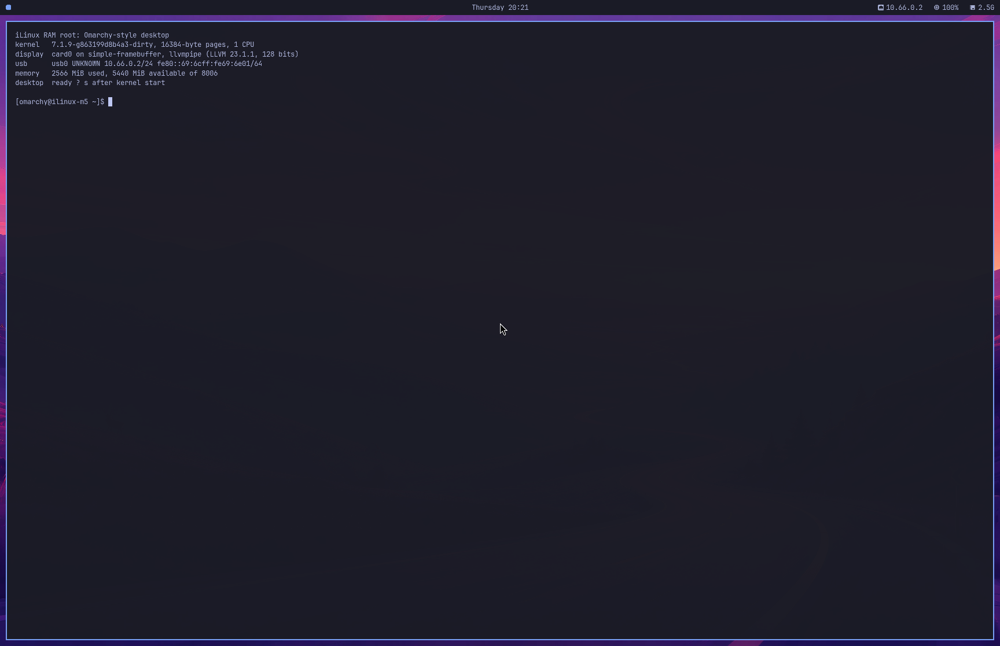

# Omarchy-style RAM root for the native M5: VM build and boot test

2026-10-15 · VM job [`039-omarchy-ram-root`](../virtualization/jobs/039-omarchy-ram-root/run.sh) ·
layer [`omarchy-arm64/ram-root/`](ram-root/README.md) · roadmap Phase 3, steps 3–4 · nothing
committed. **VM results only: nothing here ran on the M5.**

## Result

**Confirmed (VM).** One run of `host-run.sh` (6 min 25 s) does the following inside the
project's Arch Linux ARM job VM:

* builds `ramroot.cpio.zst`, 182.1 MB compressed and 853 MB unpacked, from 304 Arch Linux ARM
  packages and Omarchy's configuration;
* boots it with the exact boot035 Image (16 KiB pages) on one vCPU. The guest's only display is
  a 3456×2234 `x2r10g10b10` simple-framebuffer, handed to Linux in the device tree the way
  m1n1 hands over the M5's boot framebuffer.

What the boot test shows:

* simpledrm drives the framebuffer.
* Hyprland 0.56.2 with Omarchy's configuration composites through Mesa 26.2.4's software
  rasterizer: `llvmpipe (LLVM 23.1.1, 128 bits)`, OpenGL ES 3.2 Mesa 26.2.4-arch1.1.
* waybar and foot run, swaybg shows Tokyo Night's wallpaper, and SSH answers on the USB
  network interface `usb0`.
* The desktop was ready **76.2 s after kernel start under QEMU's TCG emulator**.
* 20 s later **2,025 MiB of RAM was in use**.
* The same job against boot036's tree and Image also reached the desktop
  ([boot036 check](#boot036-check-run-21)).

*The picture is the framebuffer memory itself, read out of the guest, i.e. what the panel
would show. It is shown at half size. Hyprland is at scale 2. The foot status terminal is the
only window; Tokyo Night's wallpaper shows around it and, faintly, through it. The status
screen's ready time reads "?" because it is printed before the desktop counts as ready.*

## Measurements

All values are from one run (run 26). Sizes are MB = 10⁶ bytes unless MiB is written.

| Quantity | Value | Label |
|---|---|---|
| Packages | 304: the 27 in `packages.txt` plus dependencies | Confirmed |
| Unpacked root | 853.2 MB (813.7 MiB), 21,620 entries; 1,605 MiB before pruning | Confirmed |
| cpio (newc, sorted, reproducible) | 856.5 MB | Confirmed |
| Delivered image, `zstd --ultra -22 --long=27` | **182.07 MB** | Confirmed |
| Transfer of the image at 4 / 5 MB/s | **45.5 s / 36.4 s** | Inferred (size ÷ rate) |
| Same, plus the boot035 Image (44.6 MB) and DT | 56.7 s / 45.3 s | Inferred |
| Kernel start → desktop ready, TCG, one vCPU | **76.2 s** | Confirmed (VM, emulated CPU) |
| Same, scaled to native CPU speed | **9–18 s** | Hypothesis (see below) |
| RAM in use 20 s after the desktop (MemTotal − MemFree) | **2,025 MiB** of 8,007 | Confirmed (VM) |
| CPU at the idle desktop, 10 s sample | 3.1 % of the one vCPU (TCG) | Confirmed (VM) |
| Failed systemd units | 0 | Confirmed (VM) |

Compression (12 threads to compress, 1 thread to decompress):

| zstd | Bytes | Compress | Decompress | At 4 / 5 MB/s |
|---|---|---|---|---|
| `-3` | 254,547,163 | 0.2 s | 0.50 s | 63.6 / 50.9 s |
| `-19` | 192,172,695 | 23.3 s | 0.57 s | 48.0 / 38.4 s |
| `-19 --long=27` | 185,105,685 | 28.5 s | 0.58 s | 46.3 / 37.0 s |
| `--ultra -22 --long=27` (delivered) | 182,068,943 | 151.4 s | 0.60 s | 45.5 / 36.4 s |

Decompression is the build VM's single-thread speed. The kernel decompresses the image on its
one CPU at boot. `--ultra -22 --long=27` is 10.1 MB (2.5 s at 4 MB/s) smaller than `-19` and
72.5 MB (18 s) smaller than `-3`, for about 2 more minutes of build time. Its 128 MiB window is
no concern with 126 GiB of RAM.

### Boot timeline

Seconds since kernel start, TCG, from the guest's journal and dmesg (run 26):

| Event | s |
|---|---|
| simpledrm bound to the DT framebuffer | 0.3 |
| initramfs unpacked (zstd → 21,620 files in tmpfs) | 4.6 |
| `/init` (bind-mount shim) → systemd | 4.9 |
| SSH socket listening on 10.66.0.2:22 | 10.1 |
| udev done with `/dev/dri/card0`; Hyprland starts; `graphical.target` | 15.4 |
| Xwayland, swaybg and foot connect | 29.3–29.4 |
| waybar "Bar configured" | 76.3 |
| desktop ready (output, wallpaper layer, waybar layer and foot window all exist) | **76.2** |

TCG timings vary between runs: runs 20–26 reached the desktop in 62.3–76.2 s. Run 26 is the
slowest. Since run 25 (fast compression) the wallpaper is also decoded on the one vCPU, but
that is not the whole difference: run 25 decoded it as well and took 67.6 s.

**Native time (Hypothesis).** The same binaries, run on the same file, are slower in the TCG
guest than in the build VM: gzip 4.3×, zstd 8.9×. Dividing 76.2 s by those factors gives
9–18 s from kernel start to desktop on a native CPU. llvmpipe's vector code may suffer more
under TCG than these integer benchmarks, which would make the native time shorter. Not
covered here:

* t6050 device probing, which this VM does not exercise;
* m1n1 and the transfer, about 45–57 s at 4–5 MB/s.

Power-on to desktop over the proxy would then be roughly 1–1.3 minutes.

### Memory at the desktop

| Item | MiB | Notes |
|---|---|---|
| Shmem | 1,183 | The tmpfs root (813.7 MiB) plus display buffers: Hyprland's swapchain is 3 × 29.5 MiB, plus the clients' shared-memory buffers |
| Anonymous | 435 | Hyprland's PSS is 474 MB: llvmpipe render targets at 3456×2234 and LLVM. Then waybar 40, Xwayland 28, foot 21, systemd and udev about 7 each |
| Slab | 50 | |

Natively, also count the kernel's page array: 64 bytes per 16 KiB page, about 0.49 GiB for
126 GiB. It is outside MemTotal (Inferred).

## What the job does

`host-run.sh` takes the `vm` lock, then calls `tools/vm-job.sh` with a read-only share of the
pinned Omarchy clone. `run.sh` then works inside the job VM:

1. **Packages.** It installs [`packages.txt`](ram-root/packages.txt) into a tmpfs root:
   * pacman uses its own `pacman.conf`, pointed only at the official mirror
     `https://fl.us.mirror.archlinuxarm.org`, with `SigLevel = Required`;
   * the keyring is the job's own, populated from the VM's `archlinuxarm-keyring 20240419-2`
     (Arch Linux ARM Build System key `77193F152BDBE6A6`);
   * the VM's own `pacman.conf`, which uses `arm-mirror.omarchy.org` and `[omarchy]`, is not
     used.
2. **Kernel modules** for the USB link: `usbnet`, `cdc_ether`, `cdc_ncm`, `libcomposite`,
   `u_ether`, `usb_f_eem`, `usb_f_ncm` and `usb_f_ecm`.
   * Only those the target tree builds as `=m` are made; boot036 builds the gadget stack in.
   * They are built as external modules against the read-only kernel tree, because the
     boot034/035 tree's own `.ko` files are stale (see problems found).
   * `KTREE`, `KERNEL` and `IMAGE_SHA` in `out/job.env` select another Image and its tree; the
     default is boot035.
3. **Omarchy** at upstream commit `9480d1b` (Omarchy 4, `version` 4.0.0.alpha):
   * `bin/`, `config/`, `default/` and `themes/tokyo-night` go to `/usr/share/omarchy`;
   * `config/` is copied to `~/.config` and `default/bashrc` to `~/.bashrc`;
   * Tokyo Night is rendered by Omarchy's own `omarchy-theme-set-templates`, run in the image.
4. **The RAM-root layer** ([`ram-root/`](ram-root/README.md)):
   * the units, the `/init` shim, networkd and SSH files;
   * a RAM-root edition of `~/.config/hypr/hyprland.lua`, `hypr/ramroot.lua`, and a waybar
     configuration.
5. **Pruning and checks.**
   * [`prune.sh`](ram-root/prune.sh) removes documentation, translations, headers, Python, Perl,
     Hyprland's 47 MB of default wallpapers, the GCC sanitizer runtimes and 228 MB of unused
     Nerd Font faces.
   * An ELF scan runs before and after pruning, and the build fails if pruning removed a
     library that a remaining binary needs.
   * systemd's `.updated` stamps are written, so the update units (ldconfig, journal catalog)
     do not run on every boot.
6. **Packing.** A sorted, reproducible newc cpio, compressed with zstd at four settings for the
   table above. The delivered image is `out/ramroot.cpio.zst`.
7. **Boot test:**
   * QEMU 11.1.2 (ALARM package, in a separate tools root inside the VM) runs with TCG, one
     vCPU and 8 GiB;
   * the device tree is QEMU virt's own, plus a 32 MiB `no-map` reserved region and a
     `/chosen/framebuffer@220000000` simple-framebuffer node pointing at it: 3456×2234,
     stride 13824, `x2r10g10b10`;
   * there is no firmware, no virtio-gpu and no ramfb;
   * the network device is QEMU `usb-net` on xHCI, with port 1's gadget MAC; the console is
     virtio (`hvc0`);
   * a second, uncompressed cpio carries the test-only files: an SSH test key, a service that
     prints the ready time and `/proc/meminfo` on the console, a diagnostics timer, and a
     drop-in that turns Hyprland's log file on (it records the GL renderer). The kernel
     unpacks it over the image, so the delivered image stays clean;
   * the harness reads the console log, so nothing logs into the guest while it boots;
   * then it reads the framebuffer out of guest RAM (`pmemsave`), and collects the journal,
     dmesg, the Hyprland log and measurements over SSH on `usb0`;
   * the run fails if the desktop is not reached, or if swaybg cannot load the wallpaper,
     which also checks that bubblewrap works in the session.

Native kernel command line used in the test (everything except the console):
`quiet maxcpus=1 nr_cpus=1 idle=nop arm64.nowfxt cpufreq.off=1`.

## Desktop and access

| Piece | How | Label |
|---|---|---|
| Session | `ilinux-desktop.service` runs Hyprland as `omarchy` on tty1 with `PAMName=login` and `LIBSEAT_BACKEND=seatd`, through `setpriv`, which drops the ambient `CAP_WAKE_ALARM` that pam_systemd gives local-seat sessions (problem 8). Omarchy 4 itself uses SDDM and uwsm, which need Python | Confirmed (VM) |
| Seat | seatd 0.9.3 (`Seat opened with backend 'seatd'`) | Confirmed (VM) |
| Display | simpledrm, connector `Unknown-1`, 3456×2234@60, atomic modesetting, linear XR24 swapchain of 3 | Confirmed (VM) |
| Renderer | `llvmpipe (LLVM 23.1.1, 128 bits)`, OpenGL ES 3.2 Mesa 26.2.4-arch1.1. Mesa's GBM loader `dri_gbm.so`, `libgallium-26.2.4` and `libLLVM.so.23.1` are mapped in Hyprland. llvmpipe starts no rasterizer threads on a one-CPU machine | Confirmed (VM; Hyprland's log) |
| Omarchy configuration | Omarchy's Lua defaults (bindings, look and feel, window rules, Tokyo Night borders) minus `default.hypr.autostart`, which would start the Quickshell shell, first-run provisioning, power profiles and udiskie | Confirmed (VM) |
| Bar | waybar 0.15.0, written in Omarchy 3's style: workspaces, clock, `usb*` address, CPU, memory. Omarchy 4 replaced waybar with its Quickshell shell (Qt 6), which this image leaves out | Confirmed (VM) |
| Terminal | foot 1.28.0, Omarchy 4's own default (`xdg-terminal-exec`), with Omarchy's `foot.ini` and theme. It opens a status screen, because the M5 has no input yet | Confirmed (VM) |
| Scale | 2. Omarchy's `auto` picked 1, because simpledrm reports a 96-dpi size (914×591 mm) | Confirmed (VM) |
| USB link | The gadget side is one network function per device-mode controller (`ilinux-usb-gadget@<udc>`, started by udev). CDC-EEM is the default, with NCM or ECM selectable: the ADT's `usb-drd0`–`2` nodes carry a `ncm-interrupt-ep-disabled` property (Observed; value not in the sanitized dump). Port numbers, MACs and USB strings are those of boot036's Stage-B init: UDCs `2a2280000.usb`, `2aa280000.usb` and `382280000.usb` (`usb-drd0`–`2`) are ports 1–3; port N's gadget MAC is `02:69:6c:69:6e:0N` and the M1 side's `02:69:6c:69:6f:0N`, so the M5 end is `fe80::69:6cff:fe69:6e0N` (EUI-64) in both stages. `bcdDevice` 0x0039 tells the RAM root from Stage-B (0x0036). Interfaces keep their u_ether names `usb0`, `usb1`, …; networkd gives the cabled one 10.66.0.2/24 and runs a DHCP server (10.66.0.10–13) | VM: host side only (see below) |
| SSH | `ilinux-sshd.socket` listens on **10.66.0.2:22** (`FreeBind`, so boot never waits for the cable), which exists only on the USB link; key-only logins. Keys come from `/etc/ssh/authorized_keys.d/<user>`, from the build or a 4-byte-aligned cpio appended at delivery | Confirmed (VM) |

In the VM, the USB link is QEMU's `usb-net` seen from the host side: `cdc_ether` gives `usb0`,
networkd configures it, and SSH works through it. QEMU's device carries port 1's gadget MAC,
so `usb0` has port 1's address, `fe80::69:6cff:fe69:6e01` (runs 21–22). The gadget side has
no device-mode controller in a VM. Only this much ran: with boot035, creating the configfs EEM
function loaded `usb_f_eem` and `u_ether` through the function's alias; with boot036's
built-in stack it needed no module (run 21). Binding to a UDC is untested (Hypothesis).

## boot036 check (run 21)

**Confirmed (VM).** Run 21 pointed `KTREE`, `KERNEL` and `IMAGE_SHA` in `out/job.env` at the
boot036 tree and Image (SHA-256 `fe73fcdc…df924e`, `7.1.9-g863199d8b4a3-dirty #14`), with
`FAST=1` (zstd `-3` only). It passed in 2 min 49 s:

* `CONFIG_USB_LIBCOMPOSITE`, `CONFIG_USB_U_ETHER` and `CONFIG_USB_F_EEM`/`NCM`/`ECM` are `=y`,
  so the job built only `usbnet`, `cdc_ether` and `cdc_ncm`;
* the gadget check created the EEM function in configfs with no gadget module loaded;
* the desktop was ready 68.4 s after kernel start (TCG), with 0 Hyprland restarts,
  `llvmpipe (LLVM 23.1.1, 128 bits)`, 1,951 MiB in use, 16 KiB pages and 0 failed units.
  boot035 took 67.9 s in run 20 and 71.6 s in run 22, so TCG timings vary by a few seconds
  between runs, and run 21 shows no speed difference between the Images;
* `usb0` had `fe80::69:6cff:fe69:6e01`, port 1's address in boot036's scheme, and the
  harness's SSH session ran over it.

The delivered image and every other figure in this report come from the boot035 build.

## 16 KiB pages

* **Confirmed:** the guest runs the boot035 Image with 16,384-byte pages (`getconf PAGESIZE`;
  32 MiB huge pages). Everything in the image that ran worked on it: systemd 262, seatd,
  Hyprland, Xwayland, Mesa llvmpipe with LLVM 23, waybar (GTK 3), foot, swaybg, OpenSSH 10.6,
  bubblewrap, and glycin's sandboxed image loader.
* **Confirmed:** static scan of all 2,271 ELF files in the image:
  * 0 have a loadable segment that a 16 KiB kernel cannot map (alignment below 16 KiB or a
    mismatched offset);
  * 0 link jemalloc or tcmalloc;
  * 9 name a library that is not installed. All are optional plugins or tools whose
    dependencies Arch does not pull in: gpsd's Qt binding, `ssh-sk-helper` (libfido2), and
    plugins for mpg123 SDL, jack firewire, glycin HEIF, `tiffgt`, `sensord`, `arpd` and
    `memusagestat`.
* **Confirmed:** ALARM's jemalloc 5.4.0 initialises on the 16 KiB-page build VM; it was
  preloaded into `ssh -V`. Quickshell, Omarchy 4's shell, links it. So jemalloc's page size
  does not block the full Omarchy 4 shell; Quickshell itself was not run.
* **Confirmed:** glycin's image loader (`glycin-image-rs` in bubblewrap with glycin's seccomp
  program) decodes the wallpaper on the 16 KiB kernel (runs 25–26). Its earlier failure had
  nothing to do with the page size (problem 8).
* **Not tested here (Unknown):** Omarchy's heavier defaults outside this image, such as
  Chromium, Electron apps and Quickshell/Qt 6. Those need their own run on a 16 KiB kernel.

## Problems found and fixed on the way

| # | Problem | Evidence | Fix | Label |
|---|---|---|---|---|
| 1 | **Nested KVM in the job VM does not deliver the guest's timer interrupts** | With `--nested`, KVM starts (nVHE) and a one-vCPU guest boots. Then guest `jiffies` stayed at `0xfffedbd4` (204 ticks = 0.8 s at HZ=250) from 32 to 92 s, while its clock read 8.3 s; the vCPU was in `cpu_do_idle` in 18/18 samples. The stall also happened with `idle=nop`, the PL011 console and the virtio console. Evidence: `out/evidence-nested-kvm/` | The boot test uses TCG (`VM_ACCEL=kvm` with `NESTED=1` keeps the KVM path) | Confirmed |
| 2 | The boot034/035 tree's `.ko` files carry vermagic `7.1.9-g863199d8b4a3`, the Image `…-dirty`, so none of them loads | `modinfo` vs the Image's strings | Build the eight needed modules as external modules against the read-only tree | Confirmed |
| 3 | An uncompressed cpio appended to a compressed initramfs is rejected unless it starts on a 4-byte boundary | `Initramfs unpacking failed: invalid magic at start of compressed archive`; 334,274,882 mod 4 = 2 | Pad with zeros before appending (the key overlay at delivery needs the same) | Confirmed |
| 4 | The root of an initramfs boot is the kernel's rootfs, which `pivot_root` cannot leave, so bubblewrap (glycin, flatpak) and anything like it would fail | pivot_root(2): rootfs cannot be pivoted away. Not reproduced here: bubblewrap was only tested with the fix in place | `/init` bind-mounts rootfs onto itself (no copy, no extra RAM) and then execs systemd. With it, bubblewrap works as root and as the user (runs 13–22) | Fix Confirmed; the failure without it: Likely |
| 5 | Hyprland's first start aborted every boot: `Couldn't open a gbm fd` | Crash report backtrace at `CHyprOpenGLImpl::CHyprOpenGLImpl()+0x2380`, the string read at the abort site. simpledrm has no render node, so Hyprland opens `/dev/dri/card0` itself as the user | `ExecStartPre=udevadm wait /dev/dri/card0`. 0 restarts in runs 16–26, against 1 in runs 11–14 | Fix Confirmed; cause (udev not yet done with the node's permissions): Likely |
| 6 | edk2 with ramfb gave an 800×600 GOP framebuffer | Run 1 screenshot | Replaced by the DT simple-framebuffer at the panel's size | Confirmed |
| 7 | Omarchy's `auto` scale picks 1 on simpledrm | `hyprctl monitors` | Scale 2 in `hypr/ramroot.lua` | Confirmed |
| 8 | **No image loaded through glycin**: swaybg's wallpaper failed with `Loader process exited early with status '1'` | A test-only `bwrap` wrapper (`bwrap-trace.sh`, runs 23–25) recorded bubblewrap's own error: `Unexpected capabilities but not setuid, old file caps config?`. Hyprland, and so everything it started (swaybg, waybar, foot, Xwayland), held `CAP_WAKE_ALARM` as an ambient capability (`CapAmb 0000000800000000`). pam_systemd sets that by default for sessions on a local seat (pam_systemd(8), systemd 254 and later); bubblewrap refuses to run when a non-root caller has any permitted capability (`acquire_privs()` in `bubblewrap.c`). The user manager's own services had no ambient capability, which is why uwsm, which runs Hyprland as a user service, does not hit this. glycin's seccomp program, decoded with `seccomp_bpf.py`, played no part: it allows everything except namespace, mount, keyring, NUMA and perf calls | `ExecStart=/usr/bin/setpriv --ambient-caps=-all --inh-caps=-all /usr/bin/Hyprland`. Runs 25–26: the session's capability sets are empty and the wallpaper loads. The boot test now fails if it does not | Confirmed (VM) |

Problem 8 reached further than the wallpaper:
* gdk-pixbuf 2.44 sent the WebP wallpaper to glycin even though webp-pixbuf-loader is
  installed. Its loader cache lists no other module, so every image a GTK program in the
  session loads through gdk-pixbuf goes to glycin (Likely): icons, thumbnails, image viewers.
* Anything else that runs bubblewrap from the session, flatpak for one, would have failed the
  same way (Likely; bubblewrap's check, not tested).
* By pam_systemd's documented default, a Hyprland started from a TTY login gets the same
  ambient capability (Likely; not tested here). The fix belongs in whatever starts the session.

## Open items

* **Time to desktop on real hardware is unmeasured.** The table's native figure is an estimate
  from TCG.
* Under TCG, waybar is the slowest client: 44 s from reading its configuration (32.7 s) to "Bar
  configured" (76.3 s). GTK's accessibility bus starts with it (`at-spi`). `NO_AT_BRIDGE=1` would skip
  that; it is not set.
* Xwayland starts with the session (Omarchy enables it) and holds 28 MB PSS. Nothing in the
  image needs it.

## What must change for the native M5 (no GPU, one CPU, busy idle)

* **Delivery.** `native/boot/launch.py` loads `initramfs-stage-b.cpio.gz` (302 KB). It needs to
  load `ramroot.cpio.zst` (182 MB). At the observed 4–5 MB/s, the image plus the 44.6 MB Image
  take 45–57 s; the Image goes over uncompressed today. The proxy-side heap the launcher
  allocates from (`utils.memalign`) defaults to 1 GiB, so the image fits (Likely).
* **Boot arguments.** The launcher pins the diagnostic Stage-B arguments (`loglevel=8
  ignore_loglevel initcall_debug earlycon=ilinuxfb ilinux_probe_diag=1`, checked by
  `entry_guard.py`). The RAM root needs a second profile: keep `rdinit=/init maxcpus=1
  nr_cpus=1 cpufreq.off=1 pd_ignore_unused clk_ignore_unused` and m1n1's `idle=nop
  arm64.nowfxt`, and add `quiet`, so that fbcon does not draw every message at 3456×2234
  (Hypothesis about the cost).
* **Modules or a built-in gadget.** Modules must be built against the Image's own tree, so
  every new Image needs a rebuild of the RAM root: set `KTREE`, `KERNEL` and `IMAGE_SHA` in
  `out/job.env`. The vermagic check does not catch a wrong tree here: boot035 and boot036
  share `7.1.9-g863199d8b4a3-dirty`.
  * boot036 builds the whole gadget stack in (`libcomposite`, `u_ether`,
    `usb_f_eem`/`ncm`/`ecm` are `=y`). The job then builds only the host-side NIC drivers the
    VM test needs: `usbnet`, `cdc_ether` and `cdc_ncm`.
  * The gadget script loads `libcomposite` only when configfs lacks `usb_gadget`, and lets the
    function's `usbfunc:` alias load the rest. A built-in stack therefore needs no modules.
  * Label: Confirmed in the VM against boot036 (run 21, see
    [boot036 check](#boot036-check-run-21)); binding to a real controller is untested.
* **The USB link itself.** The dwc3 device-mode controller and the Type-C PHY must work
  (milestone 2). The RAM root then needs no change: udev starts one gadget per controller.
  CDC-EEM is the default, matching the main session's choice for the native control channel:
  * NCM stalled on the same SoC in the omarchy-m5 review;
  * the ADT's three ports carry an `ncm-interrupt-ep-disabled` property;
  * macOS ships `AppleUSBEEM`.
  
  Label: Likely. The M1 side should get 10.66.0.10 by DHCP and reach
  `ssh root@10.66.0.2`. Without DHCP, port N's link-local address
  `fe80::69:6cff:fe69:6e0N%<interface>` is the same as in boot036's Stage-B, so one M1
  command reaches both stages. Put the operator's public key in `out/authorized_keys` before
  building, or append it as a padded cpio.
* **Display.**
  * The VM used the M5 panel's size and the `x2r10g10b10` format the launcher already accepts.
    Whether iBoot leaves 30-bit or 8-bit is to be read on the device (Likely 30-bit).
  * Hyprland renders XRGB8888 with llvmpipe, and simpledrm converts every damaged frame to the
    native format on the CPU.
  * `udevadm wait /dev/dri/card0` covers the start race natively too (Likely).
* **One CPU, busy idle.**
  * Everything shares one core: compositor, llvmpipe rasterisation and clients.
  * At the idle desktop the system used 3.1 % of the vCPU under TCG; natively a fraction of
    that (Hypothesis).
  * With `idle=nop` the core spins whenever nothing runs, so it is never idle in power terms.
    That is a property of the boot, not of the desktop.
  * In the VM, `idle=nop` worked under TCG; under nested KVM nothing worked (problem 1).
* **No GPU.** Same path as in the VM: simpledrm plus llvmpipe. There is no G17 driver and no
  render node (Likely identical behaviour).
* **No input.** The VM guest exposes a gpio-keys device; the M5 will have none until
  MTP/DockChannel works. The desktop needs none: it starts, shows status, and is reached over
  SSH.
* **Memory.** About 2 GiB at the desktop plus the 0.5 GiB page array. 126 GiB leaves ample
  room. The tmpfs root may grow to 50% of RAM by default.
* **Security.** The image holds an SSH host key, kept stable across rebuilds in the build VM.
  Do not publish `out/ramroot.cpio.zst`. Root and `omarchy` have locked passwords and SSH
  accepts keys only.

## Exact package list (304, from `pacman -Q` of the image; the 27 named in `packages.txt` in bold)

Show

| Package | Package | Package |
|---|---|---|
| abseil-cpp `20260817.0-2` | acl `2.4.0-1` | adwaita-cursors `51.0-1` |
| adwaita-fonts `51.0-2` | adwaita-icon-theme `51.0-1` | adwaita-icon-theme-legacy `46.2-3` |
| alsa-lib `1.2.16.1-1` | alsa-topology-conf `1.2.5.1-4` | alsa-ucm-conf `1.2.16.1-1` |
| aquamarine `0.15.1-1` | at-spi2-core `2.62.1-1` | atkmm `2.28.5-2` |
| attr `2.6.0-1` | audit `4.2.1-1` | avahi `1:0.9rc5-1` |
| **bash** `5.3.20-1` | benchmark `1.9.5-2` | bluez-libs `5.87-2` |
| brotli `1.2.0-1` | bubblewrap `0.13.1-1` | bzip2 `1.0.8-6` |
| ca-certificates `20240618-1` | ca-certificates-mozilla `3.131-1` | ca-certificates-utils `20240618-1` |
| cairo `1.18.6-1` | cairomm `1.14.6-1` | **coreutils** `9.12-2` |
| cryptsetup `2.8.8-1` | curl `8.22.0-1` | dav1d `1.5.4-1` |
| db5.3 `5.3.28-7` | dbus `1.16.2-1` | dbus-broker `37-3` |
| **dbus-broker-units** `37-3` | dconf `51.0-1` | default-cursors `3-1` |
| desktop-file-utils `0.28-1` | device-mapper `2.03.43-2` | duktape `2.7.0-7` |
| e2fsprogs `1.47.4-1` | expat `2.9.0-1` | fcft `3.3.3-1` |
| file `5.48-1` | **filesystem** `2025.10.12-1` | **findutils** `4.11.0-1` |
| flac `1.5.0-1` | fmt `12.2.0-1` | fontconfig `2:2.18.3-2` |
| **foot** `1.28.0-2` | freetype2 `2.14.3-1` | fribidi `1.0.17-1` |
| **gawk** `5.4.1-1` | gcc-libs `16.1.1+r12+g301eb08fa2c5-1` | gdbm `1.26-2` |
| gdk-pixbuf2 `2.44.8-1` | giflib `6.1.3-2` | glib-networking `1:2.90.0-1` |
| glib2 `2.90.1-1` | glibc `2.43+r22+g8362e8ce10b2-2` | glibmm `2.66.10-1` |
| glslang `1:1.4.363.0-1` | glycin `2.2.2-1` | gmp `6.3.0-3` |
| gnutls `3.8.13-3` | gperftools `2.18.1-1` | gpsd `3.27.5-1` |
| graphite `1:1.3.15-1` | **grep** `3.12-2` | **grim** `1.5.0-2` |
| gsettings-desktop-schemas `51.0-1` | gsettings-system-schemas `51.0-1` | gtest `1.18.0-1` |
| gtk-layer-shell `0.10.1-1` | gtk-update-icon-cache `1:4.24.1-1` | gtk3 `1:3.24.52-2` |
| gtkmm3 `3.24.11-1` | gzip `1.15-1` | harfbuzz `14.6.0-1` |
| hicolor-icon-theme `0.18-1` | highway `1.4.0-1` | hwdata `0.412-1` |
| hyprcursor `0.1.13-7` | hyprgraphics `0.5.1-4` | **hyprland** `0.56.2-4` |
| hyprland-guiutils `0.2.2-4` | hyprlang `0.6.8-5` | hyprtoolkit `0.6.0-1` |
| hyprutils `0.14.2-1` | hyprwire `0.3.1-3` | iana-etc `20260617-1` |
| icu `78.3-1` | iniparser `4.3.2-1` | **iproute2** `7.2.0-1` |
| iptables `1:1.8.13-1` | **iputils** `20250605-1` | iso-codes `4.20.1-1` |
| jack2 `1.9.22-2` | jansson `2.15.1-1` | jbigkit `2.2-1` |
| json-c `0.19-1` | json-glib `1.10.8-1` | jsoncpp `1.9.8-1` |
| kbd `2.10.0-1` | keyutils `1.6.3-4` | **kmod** `34.2-1` |
| krb5 `1.22.2-1` | lame `4.0-1` | lcms2 `2.19.1-1` |
| leancrypto `1.9.1-1` | **less** `1:710-1` | libasan `16.1.1+r12+g301eb08fa2c5-1` |
| libasyncns `1:0.8+r3+g68cd5af-3` | libatomic `16.1.1+r12+g301eb08fa2c5-1` | libbpf `1.7.0-1` |
| libbsd `0.12.2-2` | libcap `2.78-1` | libcap-ng `0.9.6-1` |
| libcloudproviders `0.4.1-1` | libcolord `1.4.8-1` | libcups `2:2.4.20-1` |
| libdaemon `0.14-6` | libdatrie `0.2.14-1` | libdbusmenu-glib `18.10.20180917-2` |
| libdbusmenu-gtk3 `18.10.20180917-2` | libdecor `0.2.5-1` | libdeflate `1.26-1` |
| libdisplay-info `0.3.0-1` | libdrm `2.4.134-1` | libedit `20260512_3.1-1` |
| libei `1.6.0-1` | libelf `0.196-1` | libepoxy `1.5.10-3` |
| libevdev `1.14.0-1` | libevent `2.1.13-2` | libffi `3.8.0-1` |
| libfontenc `1.1.9-1` | libgcc `16.1.1+r12+g301eb08fa2c5-1` | libgcrypt `1.12.4-1` |
| libgfortran `16.1.1+r12+g301eb08fa2c5-1` | libglvnd `1.7.0-3` | libgomp `16.1.1+r12+g301eb08fa2c5-1` |
| libgpg-error `1.61-1` | libgudev `238-3` | libidn2 `2.3.8-1` |
| libimobiledevice `1.4.0-2` | libimobiledevice-glue `1.3.2-1` | libinput `1.32.0-1` |
| libjpeg-turbo `3.2.0-2` | libjxl `0.12.0-1` | libldap `2.7.1-1` |
| liblsan `16.1.1+r12+g301eb08fa2c5-1` | libmd `1.3.0-1` | libmnl `1.0.5-2` |
| libmpdclient `2.27-1` | libnetfilter_conntrack `1.1.1-1` | libnfnetlink `1.0.2-2` |
| libnftnl `1.3.2-1` | libnghttp2 `1.70.0-1` | libnghttp3 `1.18.0-1` |
| libngtcp2 `1.25.0-1` | libnl `3.12.0-1` | libnsl `2.0.1-2` |
| libobjc `16.1.1+r12+g301eb08fa2c5-1` | libogg `1.3.6-1` | libp11-kit `0.26.5-1` |
| libpcap `1.11.0-1` | libpciaccess `0.19-1` | libpipewire `1:1.6.9-1` |
| libplist `2.7.0-3` | libpng `1.6.59-1` | libproxy `0.5.12-1` |
| libpsl `0.21.5-2` | libpulse `17.0+r98+gb096704c0-1` | libquadmath `16.1.1+r12+g301eb08fa2c5-1` |
| librsvg `2:2.63.2-1` | libsamplerate `0.2.2-3` | libsasl `2.1.28-5` |
| libseccomp `2.6.0-1` | libsigc++ `2.12.2-1` | libsndfile `1.2.2-4` |
| libsoup3 `3.8.0-1` | libssh2 `1.11.1-7` | libstdc++ `16.1.1+r12+g301eb08fa2c5-1` |
| libstemmer `3.1.1-1` | libsysprof-capture `51.0-1` | libtasn1 `4.21.0-1` |
| libtatsu `1.0.5-1` | libthai `0.1.30-1` | libtiff `4.7.2-2` |
| libtirpc `1.3.8-1` | libtsan `16.1.1+r12+g301eb08fa2c5-1` | libubsan `16.1.1+r12+g301eb08fa2c5-1` |
| libunistring `1.4.2-1` | libunwind `1.8.3-1` | libusb `1.0.30-1` |
| libusbmuxd `2.1.1-2` | libutf8proc `2.12.0-1` | libverto `0.3.2-6` |
| libvorbis `1.3.7-4` | libwacom `2.20.0-1` | libwebp `1.6.0-2` |
| libwireplumber `0.5.18-1` | libx11 `1.8.13-2` | libxau `1.0.12-1` |
| libxcb `1.17.0-1` | libxcomposite `0.4.7-1` | libxcrypt `4.5.2-1` |
| libxcursor `1.2.3-1` | libxcvt `0.1.3-1` | libxdamage `1.1.7-1` |
| libxdmcp `1.1.5-2` | libxext `1.3.7-1` | libxfixes `6.0.2-1` |
| libxfont2 `2.0.9-1` | libxft `2.3.9-1` | libxi `1.8.3-1` |
| libxinerama `1.1.6-1` | libxkbcommon `1.13.2-1` | libxkbfile `1.2.0-1` |
| libxml2 `2.15.4-1` | libxrandr `1.5.5-1` | libxrender `0.9.12-1` |
| libxshmfence `1.3.3-1` | libxtst `1.2.5-1` | libxxf86vm `1.1.7-1` |
| libzip `1.11.4-1` | linux-api-headers `7.2-1` | llvm-libs `23.1.1-1` |
| lm_sensors `1:3.6.2-1` | lmdb `0.9.35-1` | lua `5.5.1-1` |
| lua54 `5.4.9-1` | lz4 `1:1.10.0-2` | lzo `2.10-5` |
| **mesa** `1:26.2.4-1` | mpdecimal `4.0.1-3` | mpfr `4.2.2-1` |
| mpg123 `1.33.7-1` | mtdev `1.1.7-1` | muparser `2.3.5-2` |
| ncurses `6.6-2` | nettle `4.0-1` | nftables `1:1.1.7-3` |
| **openssh** `10.6p1-1` | openssl `3.6.5-1` | opus `1.6.1-1` |
| p11-kit `0.26.5-1` | pam `1.7.3-1` | pambase `20260616-1` |
| pango `1:1.58.2-1` | pangomm `2.46.5-1` | pcre2 `10.49-1` |
| perl `5.42.3-1` | pixman `0.46.4-1.1` | playerctl `2.4.1-5` |
| polkit `127-3` | popt `1.19-2` | pps-tools `1.0.3-2` |
| **procps-ng** `4.0.7-1` | pugixml `1.16-1` | python `3.14.8-1` |
| re2 `2:2025.11.05-6` | readline `8.3.6-1` | **seatd** `0.9.3-1` |
| **sed** `4.10-2` | **shadow** `4.20.0.arch1-1` | shared-mime-info `2.5.1-2` |
| sndio `1.10.0-1` | spdlog `1.17.0-2` | spirv-tools `1:1.4.363.0-1` |
| sqlite `3.54.0-1` | **swaybg** `1.2.2-1` | **systemd** `262-1` |
| systemd-libs `262-1` | **systemd-sysvcompat** `262-1` | tinysparql `3.12.0-1` |
| tomlplusplus `3.4.0-1` | **ttf-jetbrains-mono-nerd** `3.5.1-2` | tzdata `2026e-1` |
| upower `1.91.5-1` | **util-linux** `2.42.4-1` | util-linux-libs `2.42.4-1` |
| **waybar** `0.15.0-3` | wayland `1.26.0-1` | wayland-protocols `1.49-1` |
| **webp-pixbuf-loader** `0.2.7-2` | xcb-proto `1.17.0-4` | xcb-util `0.4.1-2` |
| xcb-util-errors `1.0.1-2` | xcb-util-image `0.4.1-3` | xcb-util-keysyms `0.4.1-5` |
| xcb-util-renderutil `0.3.10-2` | xcb-util-wm `0.4.2-2` | xkeyboard-config `2.48-1` |
| xorg-fonts-encodings `1.1.0-2` | xorg-server-common `21.1.25-1` | xorg-setxkbmap `1.3.5-1` |
| xorg-xkbcomp `1.5.0-1` | xorg-xprop `1.2.8-1` | xorg-xwayland `24.1.14-1` |
| xorgproto `2026.1-1` | xz `5.8.4-1` | zlib `1:1.3.2-4` |
| zstd `1.5.7-3` |  |  |

## Files

* Job: [`run.sh`](../virtualization/jobs/039-omarchy-ram-root/run.sh),
  [`host-run.sh`](../virtualization/jobs/039-omarchy-ram-root/host-run.sh), and helpers:
  `elf_page_check.py`, `fb2png.py`, `summarize.py`, `guest-measure.sh`, `pc2sym.py`,
  `abort_site.py`, `seccomp_bpf.py` (decodes a seccomp program) and `bwrap-trace.sh`
  (test-only bubblewrap wrapper).
* Test-only overlay: `virtualization/jobs/039-omarchy-ram-root/test-overlay/`.
* Layer: [`omarchy-arm64/ram-root/`](ram-root/README.md).
* Outputs, gitignored, in `virtualization/jobs/039-omarchy-ram-root/out/`:
  * `ramroot.cpio.zst` and `.sha256`;
  * `results.json`, `sizes.txt`, `compression.txt`, `packages.txt`, `elf-16k-check.txt`,
    `jemalloc-page-size.txt`;
  * `test/`: journal, dmesg, Hyprland log, the full-size framebuffer PNG and grim's capture;
  * `evidence-nested-kvm/`, and `runs/` with earlier runs.
* Shared tool change: `tools/vm-job.sh` gains an optional `VZRUN_EXTRA` (extra vzrun
  arguments; unset keeps the default VM).
