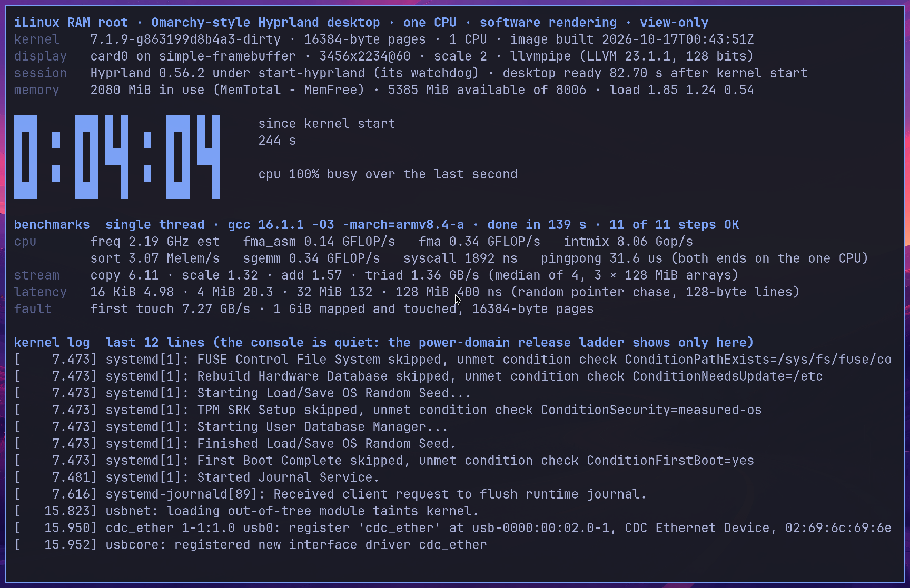

# Omarchy-style RAM root, build 2 (run 33): the live status screen, for native attempt 20

2026-10-16 · VM job [`039-omarchy-ram-root`](../virtualization/jobs/039-omarchy-ram-root/run.sh) ·
layer [`omarchy-arm64/ram-root/`](ram-root/README.md) · follows the
[run-30 report](ram-root-report-2026-10-15.md) and the M1's
[attempt-19 result](../native/boot/stage-b-2026-10-16-attempt19-result.md) · nothing committed.
**VM results only: nothing here ran on the M5.**

## Result

**Confirmed (VM).** One run of `host-run.sh` (9 min 54 s) rebuilt the image and boot-tested
it with the exact boot035 Image on one TCG vCPU, as for run 30. The image is
`out/ramroot.cpio.zst`, **182,420,823 bytes**, SHA-256 `67f257327ce308531b0c338babb8b644928cae8148bb34467042cca13cbad3f7` (run 30: 182,092,876 bytes;
the difference is the two static benchmark binaries and the scripts). Two things changed for the
person watching the M5's panel, both asked for by the attempt-19 report:

1. **Hyprland starts through `start-hyprland`.** Hyprland 0.56.2 ships it in the `hyprland`
   package: a small compiled supervisor that forks `Hyprland` with a watchdog pipe
   (`--watchdog-fd`), restarts it in safe mode after an unclean exit and returns 0 after a clean
   one. The session unit now execs it under the same `setpriv` wrapper. In the boot test the
   journal has **0** "started without start-hyprland" lines (run 30: 1, and attempt 19 showed the
   red notice for 15 s) and `Hyprland`'s parent is `start-hyprland`.
2. **The status terminal is a live screen** (`ilinux-status`), redrawn once a second in place,
   at twice attempt 19's font size: the time since kernel start in block digits with CPU use
   beside it, memory and load, the single-thread results of the repository's `cpubench` and
   `membench` (built into the image, run once by `ilinux-bench` after the desktop is ready), and
   the tail of the kernel log, which the quiet console hides. The screen forks nothing per tick
   and the benchmark is a detached process with a timeout per step: nothing waits on it.

The boot test measured, in the TCG guest:

* desktop with wallpaper ready **82.7 s** after kernel start. Run 30 took 68.4 s and runs
  20–30 spanned 62.3–76.2 s; the three builds of this screen took 81.8, 64.9 and 82.7 s (runs
  31–33). TCG timings scatter, and the screen's redraws load the emulated compositor (problem 1
  below); the native figure, 7.79 s in attempt 19, is the one attempt 20 measures again;
* **0 failed units**, 0 Hyprland restarts;
* the counter advanced between the two framebuffer captures taken 30 s apart after the ready
  marker (72 s → 91 s) and read 244 s on the final frame; the screen's own log shows tick 1 at
  32.7 s and tick 241 at 336.3 s (mean period 1.26 s under TCG, with the 2 s pre-ready phase);
* all **eleven benchmark steps finished**, 139 s after they started (TCG; done at
  224 s after kernel start), with no failed step; the numbers are emulation numbers and
  say nothing about the M5 (see below);
* 2,125 MiB in use 20 s after the desktop (run 30: 2,114 MiB).

*The simple-framebuffer memory of the guest at the end of the test, half size. The counter reads
the time since kernel start; the benchmark rows hold the TCG numbers; the kernel-log rows show
the guest's last kernel lines.*

## Measurements

| Quantity | Value | Label |
|---|---|---|
| Packages | 304, as in run 30 | Confirmed |
| Unpacked root | 855.0 MB, 21,626 entries | Confirmed |
| Delivered image, `zstd --ultra -22 --long=27` | **182,420,823 bytes** (run 30: 182,092,876) | Confirmed |
| Upload with the boot035 Image and DT, at 5 / 4 MB/s | 227,080,994 bytes: 45.4 s / 56.8 s (attempt 19 measured 5.36 MB/s: 42.28 s for 226,753,047 bytes) | Inferred |
| Kernel start → desktop ready, TCG, one vCPU | **82.7 s** (runs 31–33: 81.8, 64.9, 82.7; run 30: 68.4) | Confirmed (VM, emulated CPU) |
| Same, native attempt 19 with run 30 | 7.79 s | Confirmed (M1 report) |
| Benchmark run, TCG | 139 s for eleven steps | Confirmed (VM) |
| Same, native | about 75 s | Hypothesis (TCG slowdown 4–7× on gzip/zstd) |
| Failed systemd units | 0 | Confirmed (VM) |
| start-hyprland warning lines in the journal | 0 (run 30: 1) | Confirmed (VM) |
| RAM in use 20 s after the desktop (MemTotal − MemFree) | 2,125 MiB of 8,007 | Confirmed (VM) |

| zstd | Bytes | Compress (12 threads) | Decompress (1 thread) |
|---|---|---|---|
| `-3` | 255,102,240 | 0.2 s | 0.50 s |
| `-19` | 192,586,235 | 23.6 s | 0.57 s |
| `-19 --long=27` | 185,513,981 | 27.9 s | 0.56 s |
| `--ultra -22 --long=27` (delivered) | 182,420,823 | 152.0 s | 0.60 s |

### Boot timeline (TCG, seconds since kernel start)

| Event | s |
|---|---|
| simpledrm bound to the DT framebuffer | 0.3 |
| `/init` (bind-mount shim) → systemd | 5.1 |
| SSH socket listening on 10.66.0.2:22 | 10.3 |
| `start-hyprland` starts; `graphical.target` | 15.9 |
| status screen started (its log) | 29.85 |
| desktop ready (output, wallpaper layer, waybar layer and foot window all exist) | **82.7** |
| waybar "Bar configured" (logged after its layer exists) | 92.0 |
| benchmark run started (status log) | 84.59 |
| benchmark run done | 224.85 |

## The status screen

Rows, top to bottom, at font size 18 (116 columns × 32 rows on the 3456×2234 panel at scale 2):

| Row | Content | Source |
|---|---|---|
| title | `iLinux RAM root · Omarchy-style Hyprland desktop · one CPU · software rendering · view-only` | static |
| `kernel` | release, page size, CPU count, the image's build time | `uname`, `getconf`, `/usr/share/ilinux/build-info.txt` |
| `display` | `card0 on simple-framebuffer`, mode and scale, the renderer | sysfs, `hyprctl monitors`, Hyprland's log when enabled (the VM), else the Mesa version |
| `session` | Hyprland version, `under start-hyprland (its watchdog)` or `started directly`, `desktop ready N s after kernel start` | `pgrep`, `/run/ilinux/desktop-ready` |
| `memory` | MiB in use (MemTotal − MemFree), available, total, load average | `/proc/meminfo`, `/proc/loadavg` |
| counter | `H:MM:SS` since kernel start as 3×5 block digits; beside it the seconds and `cpu N% busy over the last second` | `/proc/uptime`, `/proc/stat` |
| `benchmarks` | header: compiler and flags, the running step or `done in N s · 11 of 11 steps OK`; then `freq fma_asm fma intmix`, `sort sgemm syscall pingpong`, STREAM `copy scale add triad` GB/s, chase latency at 16 KiB, 4 MiB, 32 MiB, 128 MiB, first-touch GB/s | `/run/ilinux/bench/{status,steps.txt,results.jsonl}` |
| `kernel log` | the last 11–12 lines (the rows left), `[seconds] message` | `journalctl -k -f` (the user is in `systemd-journal`), `dmesg -w` as the fallback |

`ilinux-bench` runs, in this order and each under `timeout`: `cpubench freq`, `fma`, `fma_asm`,
`intmix`, `sort`, `sgemm` (3 reps of 0.5 s each), `syscall` (3 reps), `pingpong` (3 reps of
20,000 round trips), `membench stream -m 128 -r 5`, `fault -m 1024 -r 3`, `latency -m 128`. It
writes `/run/ilinux/bench/results.jsonl` (the repository's JSON lines), `steps.txt` (exit status
and seconds per step) and `status`, and the status screen reads those files; a step that fails
or exceeds its limit reads `failed` on screen and the next one runs. The binaries are built by
the job from `benchmarks/src/cpubench.c` and `membench.c` with
`gcc (GCC) 16.1.1 -O3 -march=armv8.4-a -pthread`, statically, and run once inside the image root
during the build (`out/build/bench-smoke.txt`). `-march=armv8.4-a` is a fixed target that the M5
and QEMU's `max` CPU (with SVE, SME and pointer authentication off in this test) both execute; no
SME kernel is compiled in, so nothing can hit an instruction the kernel has not enabled.

### The VM's benchmark numbers (TCG; emulation, not hardware)

| Step (single thread, TCG) | Value | Unit |
|---|---|---|
| `cpubench freq` | 2.19 | GHz(est) |
| `cpubench fma` | 0.34 | GFLOP/s |
| `cpubench fma_asm` | 0.144 | GFLOP/s |
| `cpubench intmix` | 8.06 | Gop/s |
| `cpubench sort` | 3.07 | Melem/s |
| `cpubench sgemm` | 0.34 | GFLOP/s |
| `cpubench syscall` (getppid) | 1892 | ns |
| `cpubench pingpong` (both ends on the one CPU) | 31.6 | µs per round trip |
| `membench stream` copy / scale / add / triad, 3 × 128 MiB | 6.11 / 1.32 / 1.57 / 1.36 | GB/s (median) |
| `membench latency` at 16 KiB / 4 MiB / 32 MiB / 128 MiB | 4.98 / 20.31 / 132.1 / 399.7 | ns (best) |
| `membench fault`, 1 GiB first touch | 7.27 | GB/s (median) |

These are QEMU TCG numbers from one emulated CPU on the build VM and measure the emulator; they
are not M5 numbers and must not be compared with the macOS baseline. They show that every step
runs, finishes and prints in the image. The macOS single-thread baseline on this machine for
reference (clang, `-mcpu=native`, `benchmarks/results/macos-2026-10-11-parity-applem4/`): `freq`
4.51 GHz, `fma` 125 GFLOP/s, `intmix` 21.0 Gop/s, `sort` 23.4 Melem/s, `sgemm` 60.3 GFLOP/s,
STREAM copy 139 GB/s, chase 0.85 ns / 7.7 ns / 106 ns at 16 KiB / 4 MiB / 128 MiB. The native
attempt-20 values will come from a gcc build on one core with the desktop running beside them;
they are a first native measurement, not a parity figure.

## What the job does differently from run 30

* `run.sh` builds the benchmarks (before pruning, while the chroot's API mounts are up), records
  compiler, flags, source digests and `file` output in `/usr/share/ilinux/bench-build.txt`, and
  fails the build if either binary does not run in the image root; the ELF page check covers them.
* The `omarchy` user joins `systemd-journal`, so `journalctl -k` works in the session.
* The boot test takes two half-size framebuffer captures 30 s apart when the ready marker appears
  (`out/test/ready-1.png`, `ready-2.png`), then waits for the benchmark run (the test overlay's
  report service polls `/run/ilinux/bench/done` for up to 900 s and prints `ILINUX-BENCH-END`),
  then waits 30 s for the emulated compositor and captures the final frame. `guest-measure.sh` adds the session's process tree, the
  warning count, the benchmark files and the status screen's log; `summarize.py` adds
  `start_hyprland_running`, `start_hyprland_warning_in_journal`, `bench_summary`,
  `bench_end_s_after_kernel_start`.
* The run **fails** if the journal holds the start-hyprland warning, if the benchmark run did not
  finish within the wait, or if `fma_asm`, `syscall`, `stream_copy`, `latency` or
  `anon_first_touch` results are missing.

## Problems found on the way

| # | Problem | Evidence | Fix | Label |
|---|---|---|---|---|
| 1 | **Under TCG the compositor cannot keep up with a screen that changes every second.** Hyprland (llvmpipe) took the whole vCPU and its frames lagged the status screen by up to about 20 s, so two framebuffer captures 3 s apart were identical | Run 31: in the 10 s sample at the "idle" desktop Hyprland used 1,103 of 1,001 ticks (run 30, static screen: 19); the frame captured at 248 s showed the counter at 229 s; `ready-1.png` = `ready-2.png` byte for byte | The harness now captures 30 s apart (run 32: 55 s → 73 s; run 33: 72 s → 91 s), waits 30 s before the final capture and checks the screen's own heartbeat (`tick N at T s` once a minute in `/run/ilinux/status.log`: run 33 ticks 1 → 121, mean period 1.35 s with the 2 s pre-ready phase included). An emulation effect: TCG ran this guest's scalar work 8–15× slower than the build VM (gzip/zstd in `results.json`), and llvmpipe's JIT-compiled vector code slower still. Natively, attempt 19's compositor idled at 1 % CPU once the static screen was up, and re-rendering the few changed rows is milliseconds of llvmpipe work per second | Effect Confirmed (VM); native cost Hypothesis |
| 2 | The redraws during startup compete with waybar, the last client, under TCG | Run 31: desktop ready 81.8 s, waybar "Bar configured" 82.0 s (run 30: 68.4 s and 64.0 s) | The screen ticks every 2 s until `/run/ilinux/desktop-ready` exists, then every second. Run 32 then took 64.9 s and run 33 82.7 s, so the TCG scatter is larger than the effect; kept because it is free. Natively the desktop is ready about a second after the terminal appears, so the slower phase is invisible | Effect Likely (VM); fix unproven |
| 3 | Journal lines carry the host name (`ilinux-m5 systemd[1]: …`), wasting columns | Run 31 frame | Stripped, with the `kernel:` identifier (`/etc/hostname`) | Confirmed |
| 4 | The session row printed the ready time twice (`…after kernel start64.90`) | Run 32 frames | `${READY:-text}` expands to the value when it is set; replaced by an if | Confirmed |
| 5 | The `benchmarks` header overflowed the row, hiding the running step | Run 31 frame (`running membench lat`) | Shorter header: compiler and `-march` only | Confirmed |
| 6 | Two package install scripts print `arithmetic syntax error` during the pacman install (`libgpg-error`, `xcb-util-errors`) | `out/build/pacman-install.log`, also in run 30 | Harmless (hooks in the build chroot); unchanged | Confirmed |

## Open items

* **Native values are unmeasured.** Everything above is TCG. Attempt 20 is the measurement.
* The benchmark shares the one CPU with the compositor and the 1 Hz redraw; the single-thread
  numbers will read a few percent low against an idle machine (Hypothesis).
* The chase at 128 MiB may still sit inside the M5 Max's system-level cache; a larger buffer
  would need more time per step (each size is 3 × 20 M dependent loads).
* The desktop is still view-only, and the USB link is a separate track (boot039).

## Files

* Layer changes: `overlay/etc/systemd/system/ilinux-desktop.service` (start-hyprland),
  `overlay/usr/local/bin/ilinux-status` (the live screen), `overlay/usr/local/bin/ilinux-bench`
  (new), `home/.config/hypr/ramroot.lua` (the foot font size), `overlay/etc/tmpfiles.d/ilinux.conf`,
  `README.md`.
* Job changes: `run.sh`, `guest-measure.sh`, `summarize.py`,
  `test-overlay/usr/local/bin/ilinux-test-report`.
* Outputs, gitignored, in `virtualization/jobs/039-omarchy-ram-root/out/`: `ramroot.cpio.zst` and
  `.sha256`, `results.json`, `build/bench-build.txt`, `build/bench-smoke.txt`, `test/` (journal,
  dmesg, Hyprland log, `ready-1.png`, `ready-2.png`, `framebuffer*.png`, `bench-results.jsonl`,
  `bench-run.txt`, `status-screen.txt`), and `runs/run33/` with a copy of the image, its digest and
  the test outputs; `runs/run31/` and `runs/run32/` keep the two earlier builds' test outputs
  (no image), `runs/run30/` the attempt-19 build.
